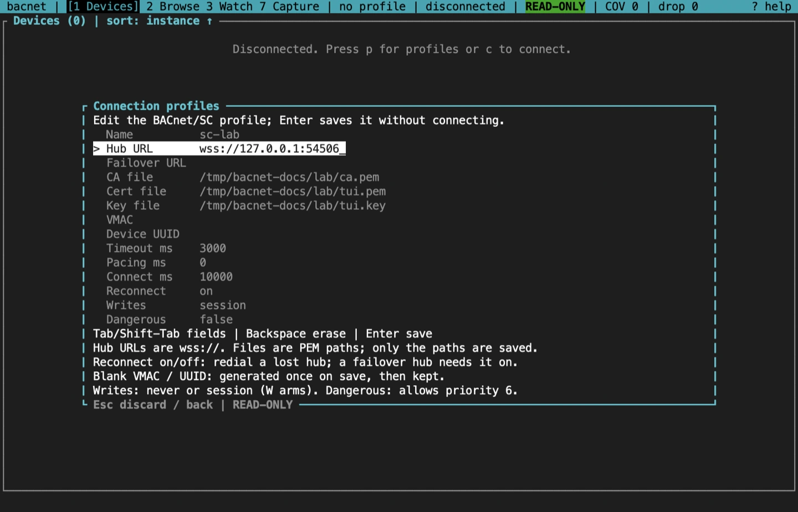
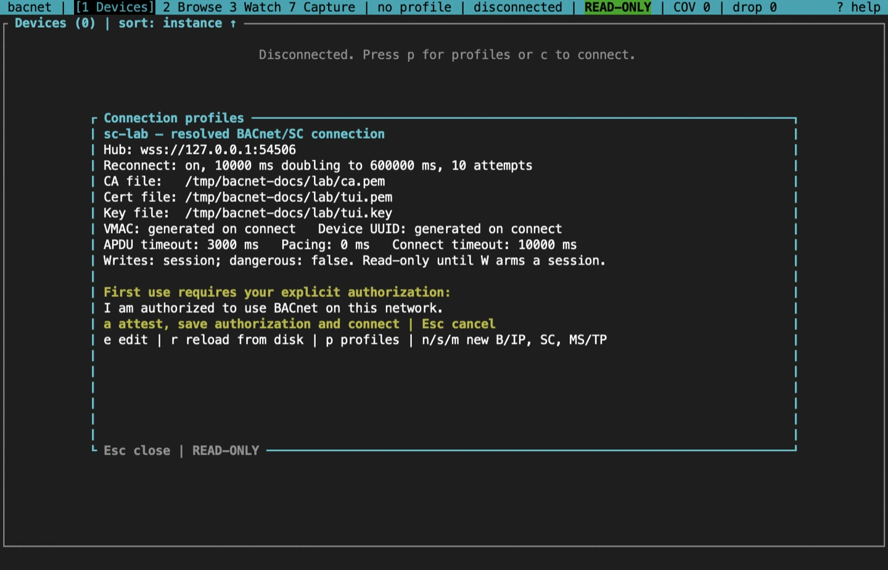
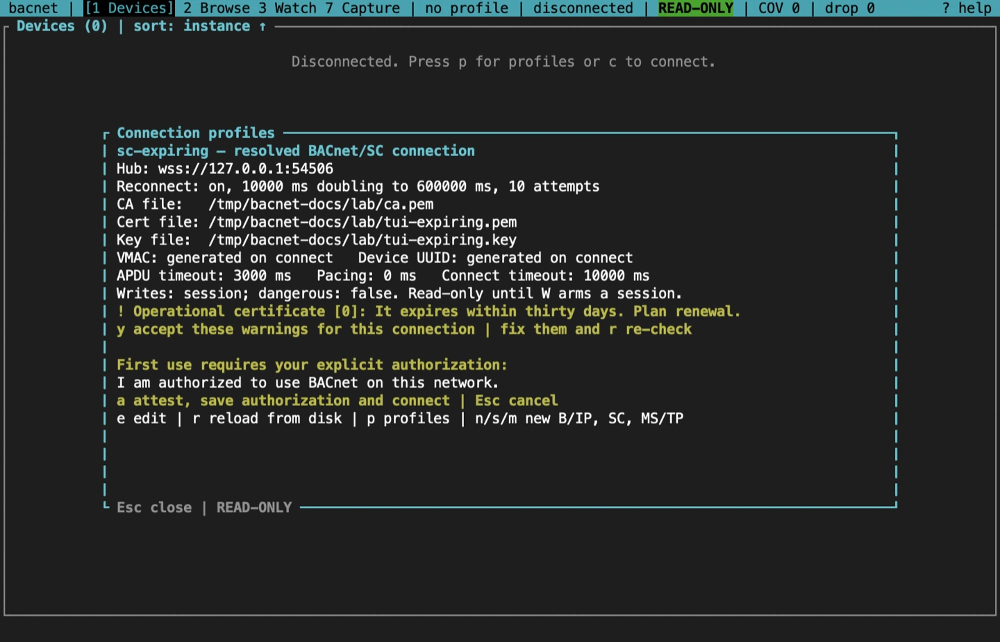
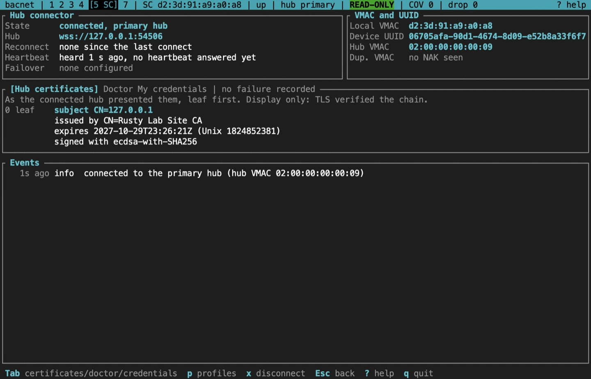
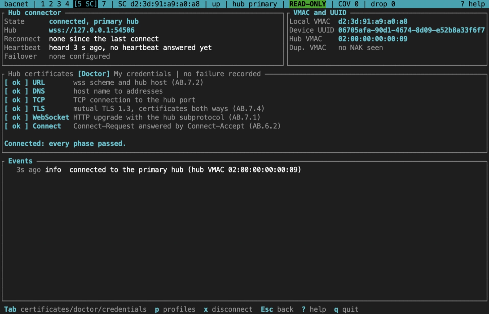
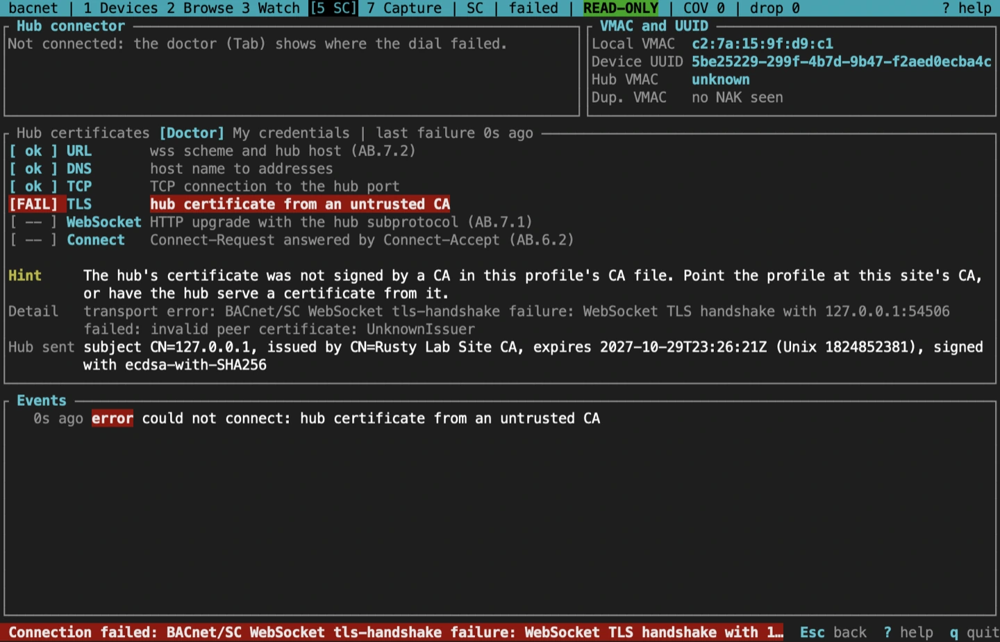
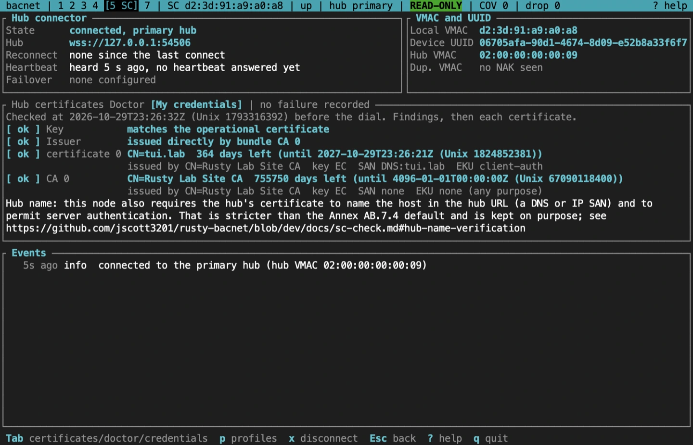
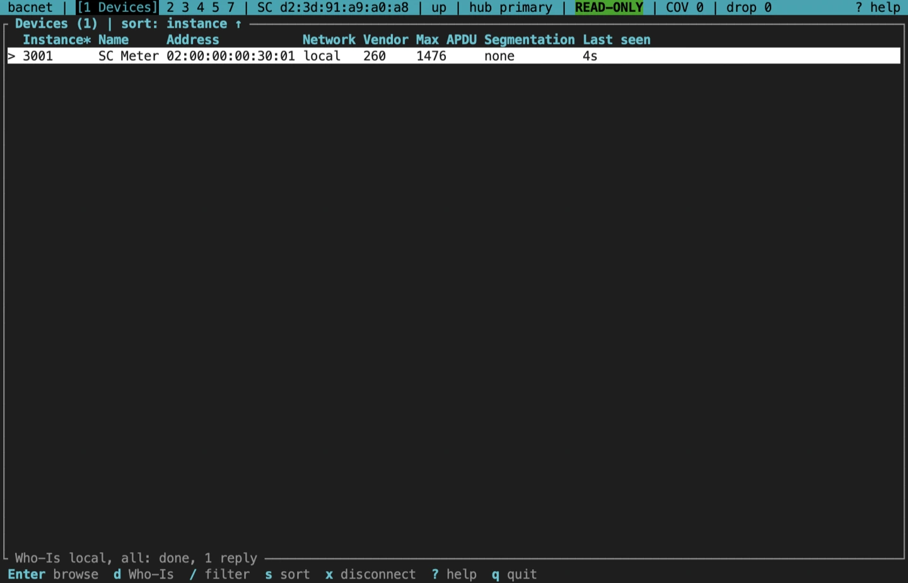

import NextStep from '../../../components/NextStep.astro';
import { release, repository } from '../../../lib/site.mjs';

BACnet/SC runs over TLS WebSockets to a hub, so most failures are certificate or connection problems, not BACnet ones. Screen `5` shows the hub connection, both sides' certificates, and a doctor that walks a failed dial phase by phase. It needs a build with the `sc-tls` feature.

## An SC profile

`s` in the profile dialog creates one. It names a primary hub URL (`wss://`, with a host and a nonzero port if a port is given), an optional failover hub URL, and the paths of the CA, certificate and key PEM files. Only the paths are saved. The CA file is the site's trust anchor; there is no fallback to the system's roots.

An SC profile reconnects on its own after it loses its hub, so a long session survives a hub restart. The first retry comes after 10 seconds, the wait doubles up to 10 minutes, and after 10 tries a failover hub, if the profile has one, takes over until the primary answers again. Set **Reconnect** to `off` in the editor (`reconnect = false` in the file) to leave a lost hub down instead. A failover hub needs reconnect on. The editor's **Connect ms** bounds each dial and handshake (10 seconds by default). The backoff itself (`reconnect_initial_delay_ms`, `reconnect_max_delay_ms`, `reconnect_max_retries`) is set in the profile file.

Flags work too: `bacnet --sc --sc-url wss://hub:443 --sc-ca ca.pem --sc-cert me.pem --sc-key me.key tui`. Add `--sc-failover-url wss://hub2:443` for a failover hub, or `--sc-reconnect` to reconnect to the one hub; without either, a flags-only session doesn't reconnect. `--sc-connect-timeout` sets the connect timeout in milliseconds. The same flags override a profile's settings.

## Before the dial

The preview checks the credentials before anything is sent:

- each file opens for reading, and on Unix the key file is not readable by group or others (a warning);
- the same credential lint as `bacnet sc-check`.

An expired or not-yet-valid operational certificate, or a key that doesn't match it, is an error: the preview names it and refuses to connect. A certificate that expires within 30 days, or one that no CA in the CA file issued directly, is a warning. Warnings hold the connection until `y` accepts the ones shown, and the check runs again just before the dial.

## The SC screen

- **Hub connector**, top left: the state and the hub in use (primary or failover), the hub's URL, the latest reconnect attempt and its backoff, and how long ago the hub was last heard, with the latest heartbeat round trip.
- **VMAC and UUID**, top right: this node's VMAC, the profile's device UUID, the hub's VMAC, and any duplicate-VMAC refusals.
- **The middle panel**, which Tab and Shift-Tab switch between three views, below.
- **Events**, at the bottom: connects, losses, reconnect attempts, failover and the primary's return, starting with the first connect. They also go to the log pane, and the status bar names the hub in use.

Each pane takes the height its content needs, and Events gets what is left. A pane that still runs out of room ends with a `+N more` line. At 80 columns long values such as the device UUID wrap rather than being cut. From 160 columns, My credentials sits beside the hub certificates or the doctor, and Tab still steps through all three.

### Hub certificates

The certificate chain the connected hub presented, leaf first, with each subject, issuer, expiry and signature algorithm, by name where it is a common one (such as `ecdsa-with-SHA256` or `sha256WithRSAEncryption`) and as its OID otherwise. TLS has already verified it; this view is for reading.

### The connection doctor

The doctor checks a dial in the order it happens: the URL, DNS, the TCP connection, TLS, the WebSocket upgrade with the hub subprotocol, and the Connect-Request and Connect-Accept exchange (Annex AB). Each phase is `[ ok ]`, `[FAIL]`, or `[ -- ]` when it was never reached.

When a dial fails, the doctor opens by itself, marks the phase that failed, and says what to try. It recognises an untrusted CA, an expired or future-dated certificate (with clock skew when the dates are close), a key that doesn't match, a certificate without client-authentication key usage, a proxy that drops the upgrade, and a duplicate VMAC.

In this example the profile's CA file is from another site, so the hub's certificate is from an untrusted CA. The fix is to point the profile at this site's CA, or to have the hub serve a certificate from it.

### My credentials

What the pre-dial lint found, first: every finding, the key match, and whether a CA in the CA file issued the certificate directly. Then this node's own certificate, its chain and the CA file as the lint read them: subject, issuer, key algorithm, SAN, EKU, and days to expiry, with a warning at 30 days and an alarm at 7. A dial the lint refused opens this view.

The note at the bottom says that this node also requires the hub's certificate to name the hub URL's host and to allow server authentication. That is stricter than the Annex AB.7.4 default, on purpose.

## Devices over SC

Discovery, browsing, watching and writing work as on B/IP. Addresses are VMACs.

## Sources and release scope

These pages describe **v{release}**. Source review is not a claim of hardware qualification. BACnet/SC is ASHRAE 135 Annex AB.

<a href={`${repository}/blob/v${release}/docs/CLI.md#plain-bacnet`}>SC screen reference</a> · <a href={`${repository}/blob/v${release}/docs/sc-check.md`}>sc-check and the credential lint</a> · <a href={`${repository}/blob/v${release}/crates/bacnet-cli/src/tui/sc/doctor.rs`}>Connection doctor</a>.

<NextStep href="/rusty-bacnet/tui/mstp/" label="Monitor and join MS/TP" description="Listen to a trunk without transmitting, then join it at a free MAC." />
