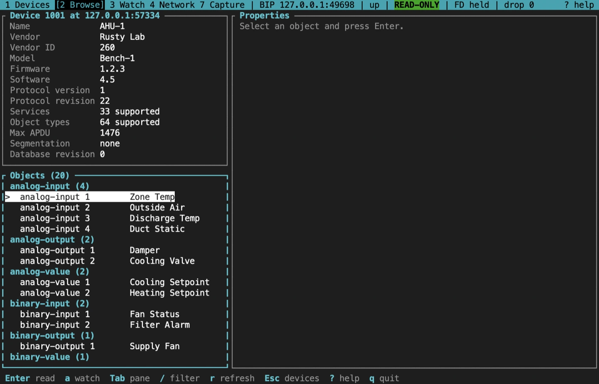
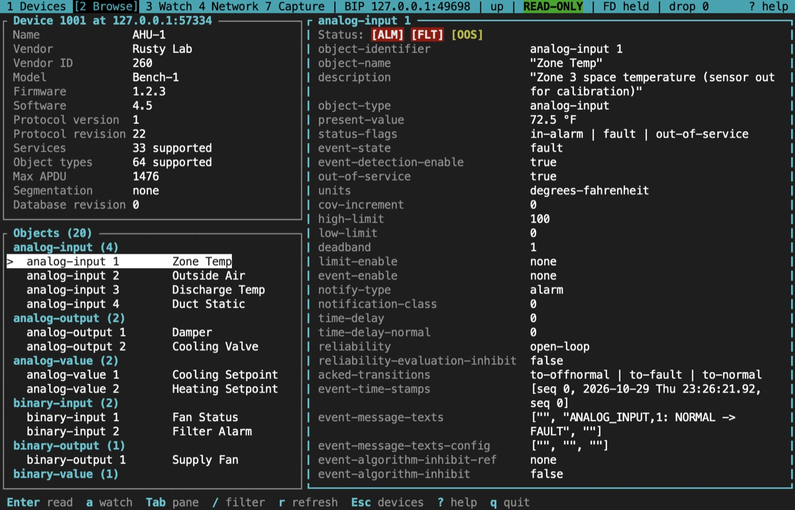
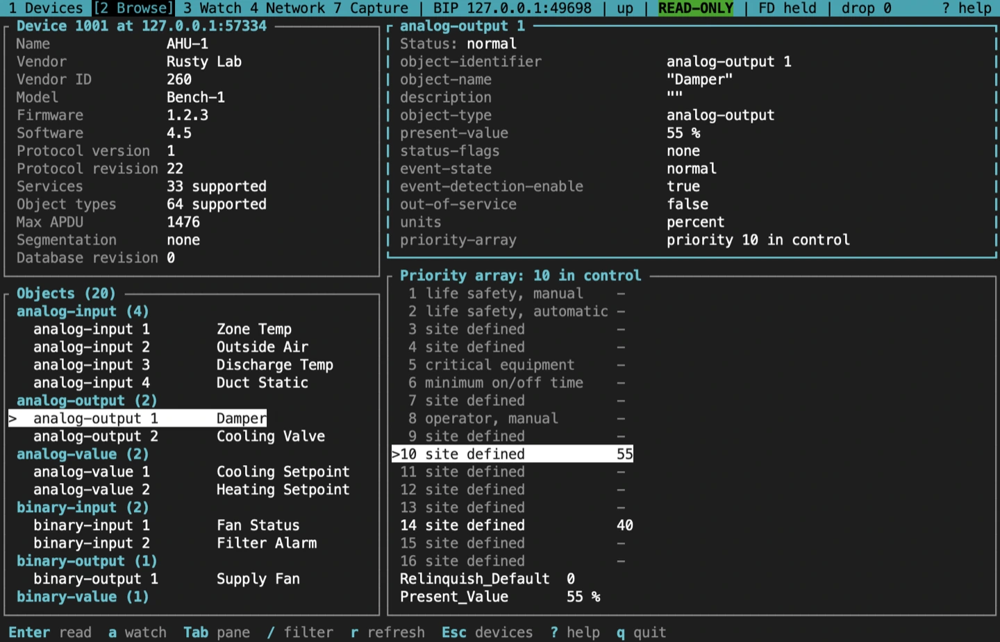
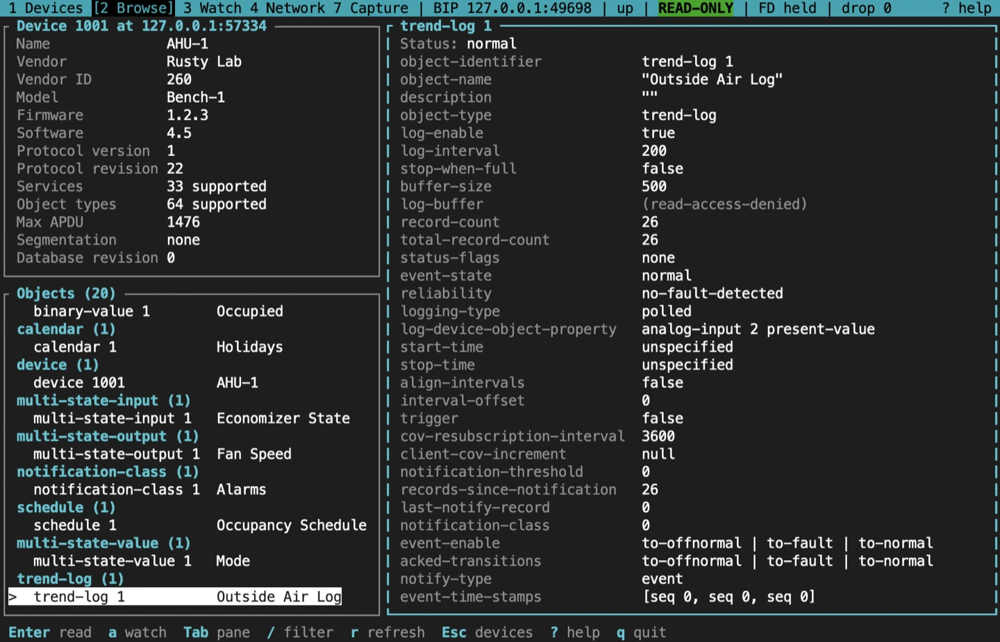
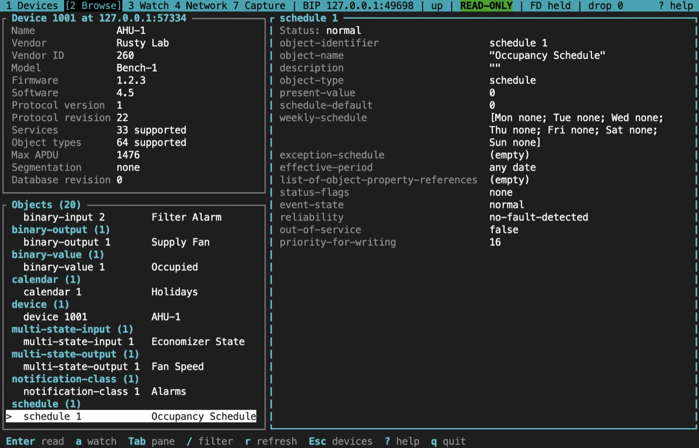
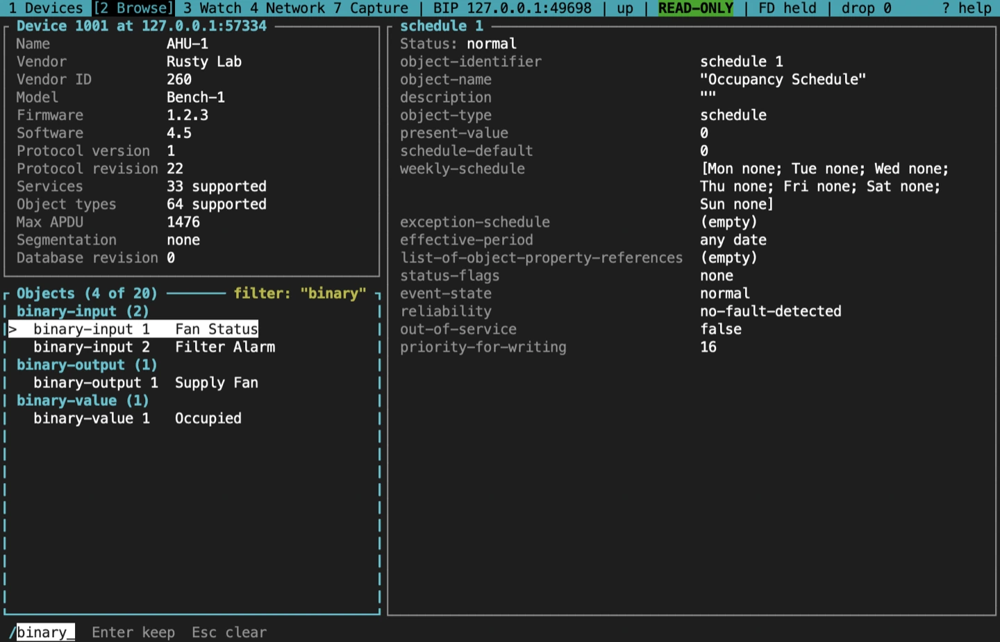

import NextStep from '../../../components/NextStep.astro';
import { release, repository } from '../../../lib/site.mjs';

Enter on a row of the device table opens the browser. It reads the device and lists its objects; nothing is written.

## Three panes

- **The device card**, top left: name, vendor and vendor ID, model, firmware and application software versions, protocol version and revision, how many services and object types it supports, Max APDU, segmentation and Database_Revision.
- **The object list**, bottom left: the device's Object_List, grouped by object type with a count per type, and each object's name after its label. Names are read only for the objects on screen, never for the whole list, and kept for the session: scrolling reads the names of the rows that come into view, `…` marks a name still being read, `-` one the device refused, and a dim `?` one that timed out, which is asked for again when the device next sends an I-Am. `r` on the card or the list reads the device again, and asks again for the names it refused.
- **The properties**, on the right: the selected object's properties, once you read it.

From 120 columns wide the panes sit side by side. Below that only the focused pane is shown, with a bar naming the panes, and Tab moves to the next one. The focused pane has a coloured border. Tab and Shift-Tab change the focus at any width.

## Read an object

Move to an object in the list and press Enter. The browser reads it and fills the property pane. `r` reads it again; Esc goes back to the device table.

Each object is read with one ReadPropertyMultiple. If the device refuses that, the browser falls back to one ReadProperty per property. An Object_List too big for one reply is read an element at a time. The browser keeps at most one request outstanding per device, and `--max-rate N` caps the requests a second across all devices (default 20; `0` for no cap). A property the device won't return shows its error in place, such as `(PROPERTY:READ_ACCESS_DENIED)`.

## Status flags and badges

The first line of the property pane sums up the object's Status_Flags in text, so the state doesn't depend on colour:

| Badge | Meaning |
|---|---|
| `[ALM]` | In alarm |
| `[FLT]` | Fault |
| `[OVR]` | Overridden |
| `[OOS]` | Out of service |
| `normal` | None of them |

Here the analog input is out of service with a reliability of `OPEN_LOOP`, so its Present_Value is not coming from the sensor. Read Reliability and Event_State next to the badges before trusting a value.

## Priority arrays

A commandable object, such as an analog output, binary output or multi-state output, also shows its 16 command priorities, Relinquish_Default and Present_Value. The slot in control is marked with `>`, and the title names it. Below 120 columns the priority array is a pane of its own, after Properties in the Tab order, so the properties keep the whole width; from 120 columns it sits under the properties, and from 160 beside them.

Each slot is labelled with its usual role: 1 and 2 for life safety, 5 for critical equipment, 6 for minimum on and off times, 8 for manual operator, and the others site defined. The highest-priority slot that holds a value, the lowest number, drives Present_Value; when every slot is empty, Relinquish_Default does (Clause 19.2). In this example a value at priority 14 sits under the one at 10 and takes over when 10 is relinquished.

## Trend Log and Schedule objects

A Trend Log shows its logging properties: Log_Enable, Log_Interval, Buffer_Size, Record_Count, Total_Record_Count, Stop_When_Full, the logged property and the start and stop times.

A Schedule shows Present_Value, Schedule_Default, Weekly_Schedule, Exception_Schedule, Effective_Period, the list of properties it writes and Priority_For_Writing.

The browser shows these as properties; it has no log-buffer table or weekly calendar view. Some constructed values, such as a Weekly_Schedule or a property reference, are shown as their raw encoded form. To read a trend log's records, use the one-shot `bacnet read-range` command.

## Filter the objects

`/` filters the object list as you type: by type, such as `binary`, by instance, or by a name already read (it reads none). The title shows how many objects match. Enter keeps the filter and Esc clears it.

## From the browser

- `a` watches the open object's Present_Value; see [Watch points](/rusty-bacnet/tui/watch/).
- `w` and `n` write and relinquish, inside an armed write session; see [Write safely](/rusty-bacnet/tui/writes/).

## Sources and release scope

These pages describe **v{release}**. Source review is not a claim of hardware qualification.

<a href={`${repository}/blob/v${release}/docs/CLI.md#plain-bacnet`}>Device browser reference</a> · <a href={`${repository}/blob/v${release}/crates/bacnet-cli/src/tui/app/browser.rs`}>Browser source</a> · <a href={`${repository}/blob/v${release}/crates/bacnet-cli/src/tui/view/browser.rs`}>Browser view</a>.

<NextStep href="/rusty-bacnet/tui/writes/" label="Write safely" description="Arm a time-boxed session, preview each write, and revert from the ledger." />
