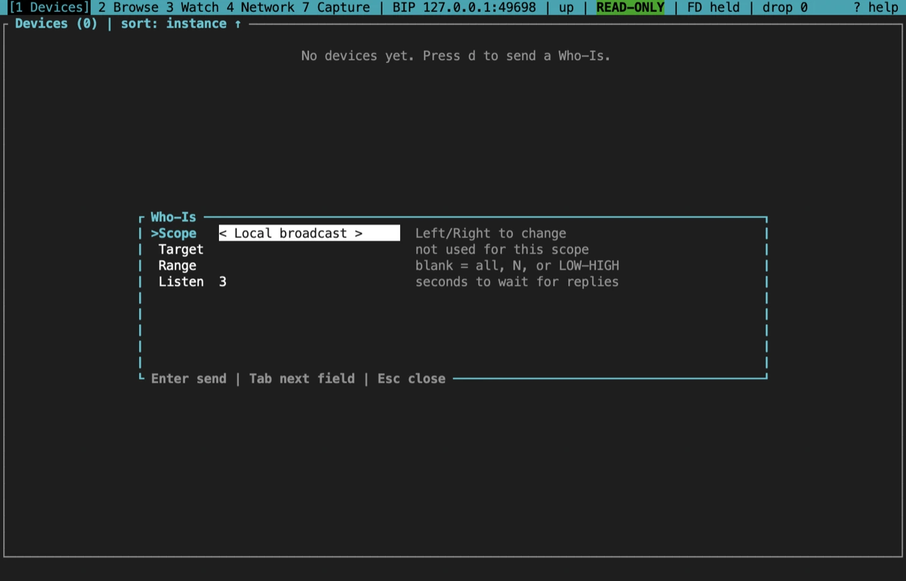
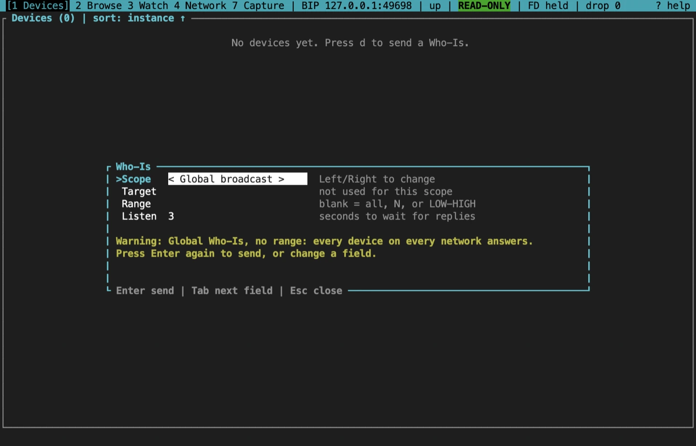
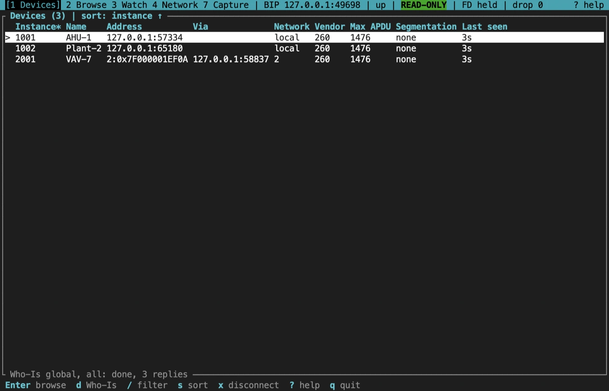
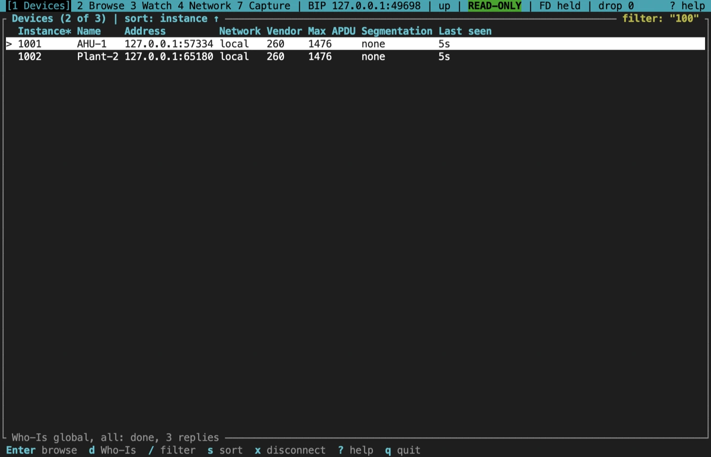
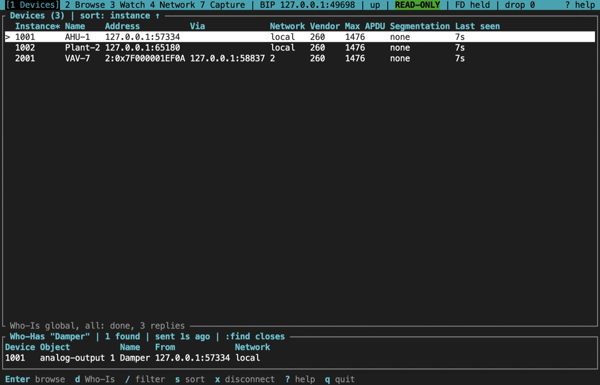

import NextStep from '../../../components/NextStep.astro';
import { release, repository } from '../../../lib/site.mjs';

Screen `1` is the device table. It lists every device whose I-Am the session has heard, and keeps them for as long as the session lasts. Nothing is discovered until you ask.

## Send a Who-Is

Press `d` for the Who-Is form.

| Field | Values |
|---|---|
| Scope | Local broadcast, global broadcast, directed to one address, or one remote network. Left, Right or Space change it |
| Target | For directed: `IP` or `IP:port` on B/IP; `bip6:N`, `bip6:0xVMAC` or `[IPv6]:port` on B/IPv6; a 12-digit VMAC on BACnet/SC. For a remote network: its network number |
| Range | Blank for every instance, one instance `N`, or `LOW-HIGH` (0 to 4194303) |
| Listen | How many seconds to show the request as running while replies arrive, 1 to 60 (default 3) |

Tab, Shift-Tab, Up and Down move between fields. Enter sends, Esc closes.

Start with the smallest scope that answers your question: a directed Who-Is to a known address, or a range. A global or unbounded Who-Is can draw an I-Am from every device on a site, so the first Enter shows a warning with the number of devices already known, and only a second Enter sends it.

Ctrl-C cancels a Who-Is that is still listening.

## Read the device table

Each row is one device: its instance, name, address, network, vendor ID, Max APDU, segmentation, and how long ago its last I-Am arrived. The bottom border shows the latest request and how many replies it got.

- **Address.** A local device shows its own address. A device behind a router shows its station in the CLI's target syntax, `NET:0xMAC`, such as `2:0x7F000001C335` (or `2:0x05` for an MS/TP station). A one-shot command takes that text back as its target, as in `bacnet read 2:0x05 ai:1 pv`, and so does the command bar, as in `:watch 2:0x05 ai:1`.
- **Name.** The device's object name. Names are read only for the rows on screen, a few at a time within `--max-rate`, and kept for the session; a name the TUI already has, from the device's card in the browser or an I-Have, costs no request. `…` means the name is being read, `-` that the device refused it, and a dim `?` that the device didn't answer; that name is asked for again when the device next answers a Who-Is. The column takes the room the others leave, a long name ending in `…`; on a narrow terminal with long addresses it is left out, and no names are read for it.
- **Via.** The router a routed device was heard through, such as `127.0.0.1:53180`. The column appears only when the whole of it fits, so on a narrow terminal with long addresses it is left out.
- **Network.** `local`, or the remote network number.
- **Vendor.** The vendor ID from the I-Am.
- **Duplicates.** When two addresses answer for one instance, a `DUPLICATE` banner names both. For a routed device it names the station with each router, such as `2:0x05 via 10.0.1.1:47808`.

Each column is as wide as its header or its widest entry, so on a wide terminal the spare room stays at the right. The instance and the address are never cut. Below 120 columns the headers are shortened (`Net`, `APDU`, `Seg`, `Seen`).

If a burst of I-Am traffic outruns the UI, events are dropped rather than queued without limit. The status bar's `drop` counter shows how many, and the table is refreshed from the client's own discovery table afterwards.

### Sort and filter

- `s` sorts by the next column: instance, address, network, vendor, last seen, then name, where names not known yet (unread, refused or unanswered) sort last either way. The sorted column is marked with `*` and the title says which. `S` reverses the order.
- `/` filters the rows by instance, name, address, router, network or vendor as you type. It matches only the names already read, and reads none; the TUI keeps the 4,096 names used most recently, so on a larger site an older name may have to be read again (by scrolling to it) before the filter finds it, and the name sort is approximate past 4,096 devices. Enter keeps the filter, and Esc clears it.
- Arrows, `j` and `k`, PgUp and PgDn, Home and End (or `g` and `G`) move.

Enter on a row opens the [device browser](/rusty-bacnet/tui/browser/).

## Find an object by name

`:find NAME` broadcasts a Who-Has for the object named NAME. The name is the rest of the line, exactly as typed, apostrophes and spaces included, so `:find Joe's office` needs no quotes. A name that is one quoted word, such as `:find "Zone  Temp"`, is unwrapped, and `:find ""` closes the panel like `:find` alone. Each device that answers with an I-Have is listed in a panel under the device table, or beside it in a terminal 160 columns wide or more when both fit, with the object it named (`analog-input 3`, as the browser labels it), the object's name, and the address it answered from, written as the device table writes it. A name too long for the panel ends in `…`. When there is room, a Via column shows the router a routed answer came through. The name has the room first: the Via column is left out rather than a name cut to fit it. `:find` on its own closes the panel.

## Routed devices and other networks

A device on another BACnet network is reached through a router. To find one:

- Send a Who-Is with the **remote network** scope and that network number, or a global Who-Is.
- On the Network screen, the Networks tab (`4`, then Tab) asks every router which networks it reaches. See [Inspect BBMDs and routers](/rusty-bacnet/tui/network/#routers-and-networks).

A routed device is browsed and watched like a local one. On the command bar, name it as `DNET:instance`, such as `:watch 2:2001 ai:1`, or by the station the table shows, such as `:watch 2:0x05 ai:1`. A station not in the table is an error: discover the device first.

## Across a subnet: foreign-device registration

On B/IP, a broadcast reaches only the local subnet. To discover devices beyond it, use a BBMD the site owner designates and join it as a foreign device: give the profile a BBMD, or start with `--foreign-bbmd ADDRESS`. The TUI registers, renews before the TTL runs out, and sends its broadcasts through the BBMD.

Connecting does not prove that the BBMD accepted the registration. The Network screen's foreign-device panel shows the result of each attempt, and a refusal raises a red banner on every screen.

## Sources and release scope

These pages describe **v{release}**. Source review is not a claim of hardware qualification.

<a href={`${repository}/blob/v${release}/docs/CLI.md#plain-bacnet`}>Devices screen reference</a> · <a href={`${repository}/blob/v${release}/crates/bacnet-cli/src/tui/app/whois.rs`}>Who-Is form</a> · <a href={`${repository}/blob/v${release}/crates/bacnet-cli/src/tui/app/who_has.rs`}>Who-Has panel</a>.

<NextStep href="/rusty-bacnet/tui/browser/" label="Browse a device" description="Read the device card, the object list and each object's properties." />
