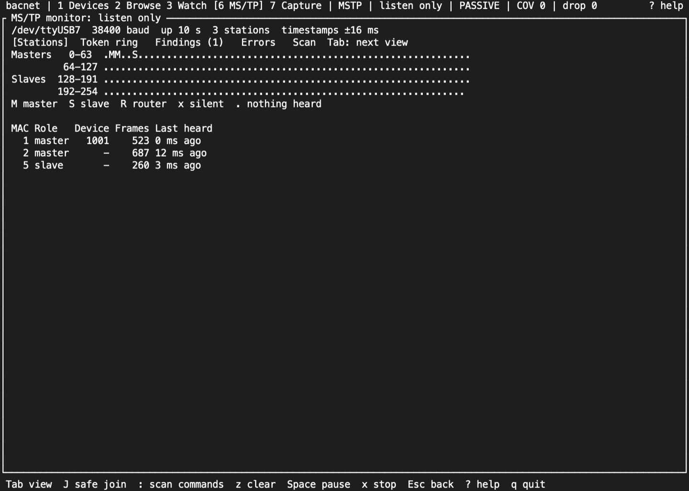
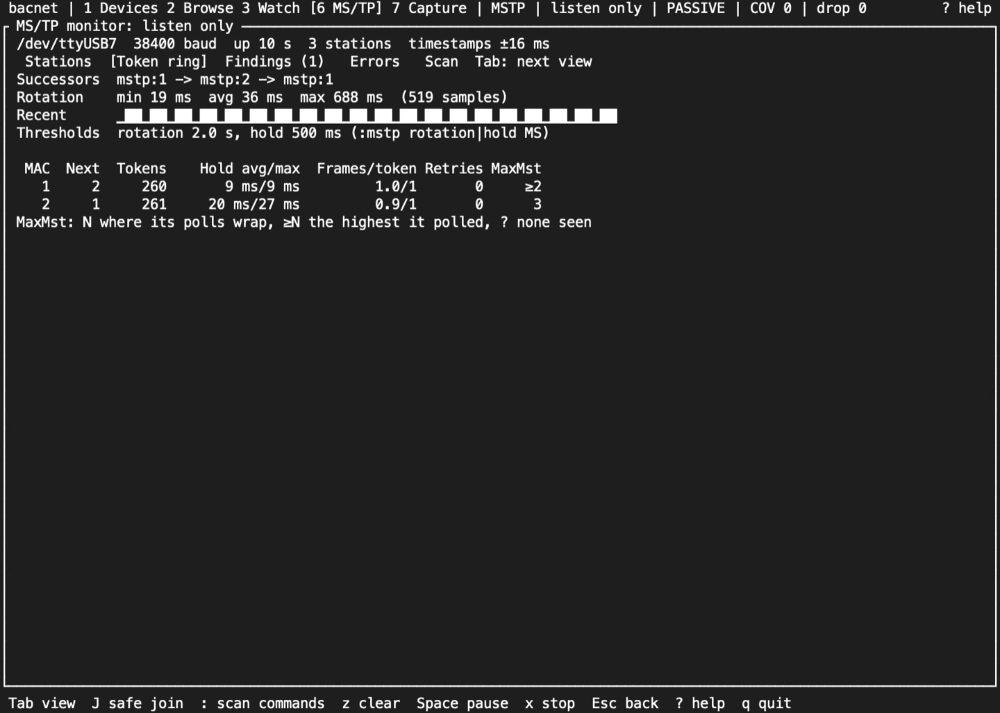
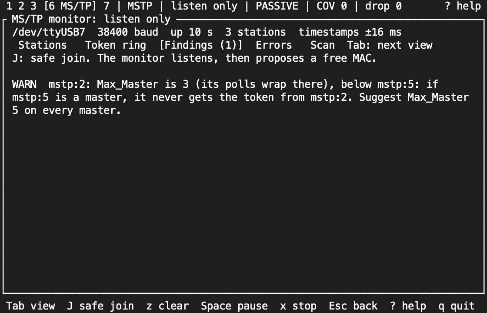
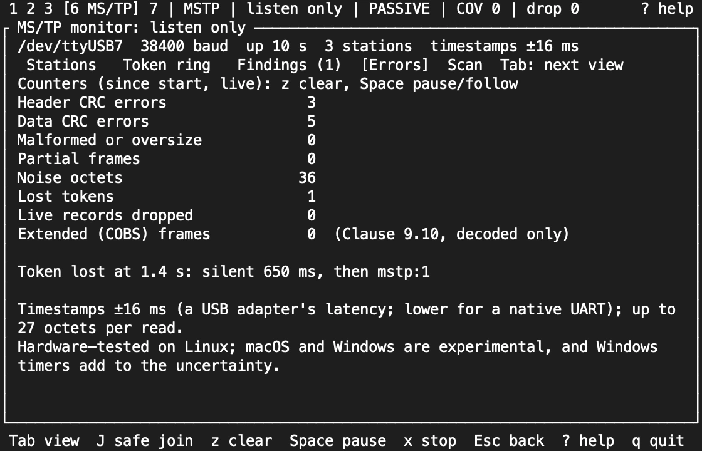
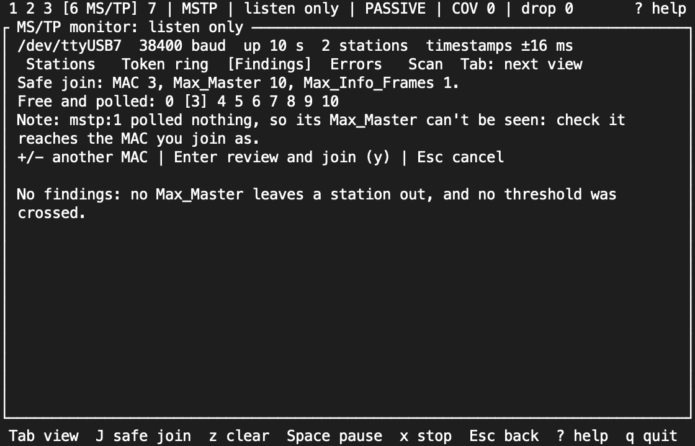
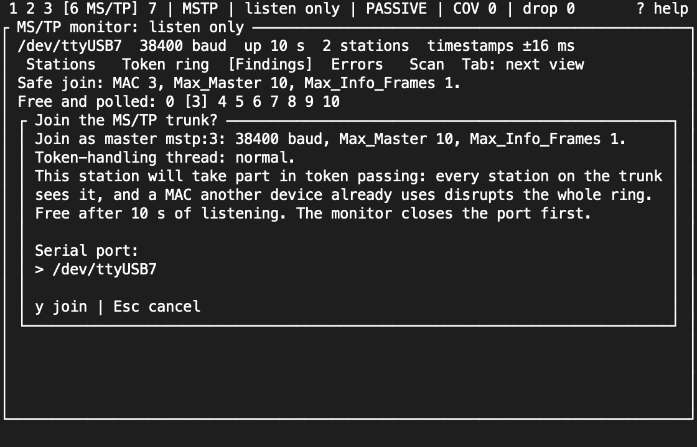
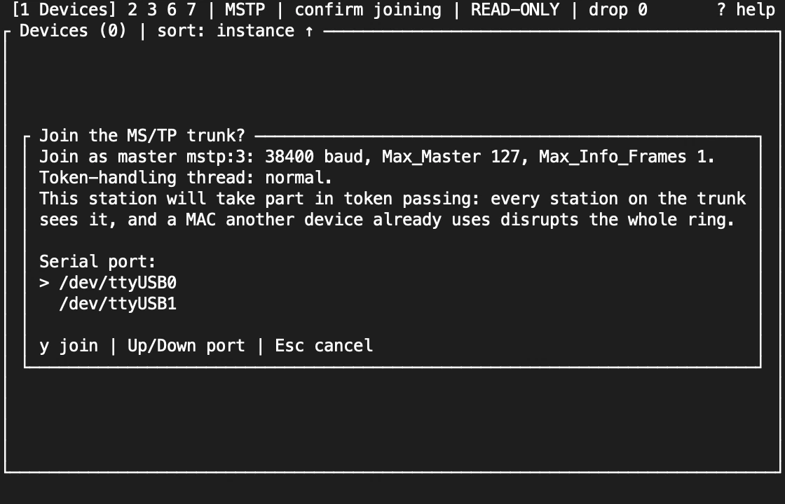
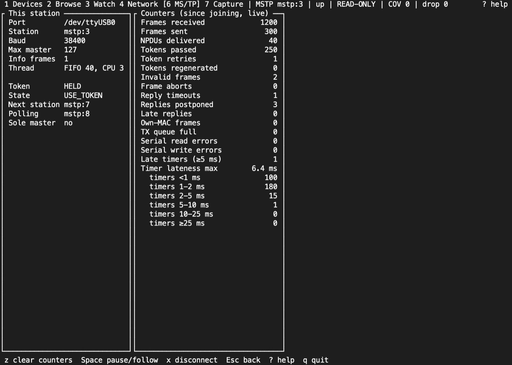

import NextStep from '../../../components/NextStep.astro';
import { release, repository } from '../../../lib/site.mjs';

An MS/TP trunk is a token ring on RS-485: every master passes the token to the next, and a station with the wrong MAC or Max_Master can disturb everyone on the wire. So the TUI has two modes. The **monitor** listens and sends nothing. A **participant** joins the ring as a master station. Start with the monitor on a trunk you don't know.

MS/TP needs a build with the `serial` feature and an RS-485 adapter that switches direction by itself. The docs lab has no trunk, so most shots on this page are frames from the TUI's snapshot tests, with simulated stations and no colour.

## Listen first: the monitor

```sh
bacnet tui --mstp-monitor /dev/ttyUSB0 --mstp-baud 38400
```

The monitor opens the port to listen only. It builds no client and drops the port's write side as it opens, so it can't transmit. The status bar reads `listen only` and the level is `PASSIVE`. It takes `--mstp-baud` and `--mstp-max-info-frames`, and refuses `--mstp`, `--mstp-mac`, `--mstp-max-master`, another transport's flags and `--profile`. On Linux it also takes `--mstp-rt-priority` and `--mstp-cpus`, but the monitor itself runs normally: only a station you join from it gets them (see [Real-time scheduling](#real-time-scheduling-linux)).

The MS/TP screen opens first. Tab moves between four views. `z` counts from now, Space pauses or follows, and `x` stops the monitor.

### Stations



A map of every address: masters 0 to 127 and slaves 128 to 254. Each address is marked:

| Mark | Meaning |
|---|---|
| `M` | A master: it passes the token or polls for masters |
| `S` | A slave: it only answers |
| `R` | A router: it sends routed or network-layer messages |
| `x` | Silent: heard before, or sent requests, but quiet for 10 s |
| `.` | Nothing heard |

Below the map is a row per station: its role, its device instance once its I-Am is seen, how many frames it sent, and when it was last heard. From 160 columns the map and the table sit side by side. When the stations don't all fit, the table's last row says how many more there are (`+N more`).

### Token ring



The successor chain, the token's rotation time (shortest, mean and longest, with a sparkline of recent rotations), and for each master: the tokens it got, how long it held each, the frames it sent per token, token retries, and its Max_Master as its polls show it. `N` means its polls wrap at N, `≥N` is the highest it has polled so far, and `?` means no poll seen yet.

### Findings



The monitor flags:

- a Max_Master that leaves a station out, only when the polls show its exact value;
- a Max_Master more than 8 above the highest station;
- a gap of more than 8 empty addresses between two masters;
- a token rotation over 2 s, and a token held over 500 ms.

Each comes with a suggestion. The two 8s are rules of thumb, not values from the standard. `:mstp rotation MS` and `:mstp hold MS` move the time thresholds.

### Errors



Header and data CRC errors, malformed or oversize frames, partial frames, noise, lost tokens with when and who started the ring again, and extended (COBS) frames, which are decoded but not interpreted (Clause 9.10). Timestamps are only as good as the adapter: the screen shows the 16 ms a USB adapter can add.

## Safe join

`J` starts the safe join from the monitor. It listens for 10 s (`:mstp listen SECS` changes that), then proposes:

- a free MAC that a master already polls, and that is within every Max_Master the line shows;
- a Max_Master that reaches every station heard;
- `--mstp-max-info-frames`.



`+` and `-` pick another free MAC. Enter opens the join confirmation, and `y` there stops the monitor, closes the port, and joins on it, so only one of them holds the port at a time. Enter and `y` each check the proposal against the newest reading first: if a station has appeared at that MAC, the dialog closes and the wizard proposes again.



The confirmation also shows how the station's token handling will be scheduled: `normal`, or the `--mstp-rt-priority` and `--mstp-cpus` settings. From then on the session is a participant at `READ-ONLY`. A join the transport refuses leaves the monitor listening, with the reason shown. If the join fails after the monitor closed the port, `c` confirms a join again; to listen again, quit and start with `--mstp-monitor`. With `--passive` the wizard proposes a MAC but never joins.

## Join directly: the participant

```sh
bacnet --mstp /dev/ttyUSB0 --mstp-mac 3 tui
```

Joining adds a master to the token ring, which every station notices, so the TUI asks before it opens the port. The dialog states the station, baud rate, Max_Master and Max_Info_Frames, and lists the serial ports: the one you gave first, then the others `bacnet mstp-ports` finds (an MS/TP profile offers its own port only). Up and Down choose the port. Only `y` joins; Esc goes back to the profile, or quits a flags-only session. Every later join, such as `c` after a disconnect, asks again. On a profile, each join you confirm is recorded in the profile's audit log (`audit.jsonl`) with the port, station, baud rate and thread settings before the port opens.

### Real-time scheduling (Linux)

```sh
bacnet --mstp /dev/ttyUSB0 --mstp-mac 3 --mstp-rt-priority 40 --mstp-cpus 3 tui
```

`--mstp-rt-priority N` runs the station's token handling under `SCHED_FIFO` at priority N (1 to 99; it needs `CAP_SYS_NICE` or `ulimit -r` of at least N), and `--mstp-cpus` pins it to those CPUs. They apply to every station the session joins, from flags, a profile or the monitor, and never to the passive monitor. A setting the kernel won't apply fails the join with the reason. The MS/TP screen's `Thread` row shows what was applied, such as `FIFO 40, CPU 3`. Compare the timer lateness with and without them: they lower scheduling delay but don't guarantee timing. On macOS and Windows both flags are refused.



As a participant, the MS/TP screen shows this station and its counters:



- **This station:** port, MAC, baud, Max_Master and Max_Info_Frames; whether it holds the token; the master state machine's state; the next station and the one it is polling; and a warning when it believes it is the only master.
- **Counters,** read once a second: frames received and sent, NPDUs delivered, tokens passed, retried and regenerated, invalid and aborted frames, reply timeouts, postponed and late replies, frames from another station with this MAC, transmit-queue refusals, serial errors, and timer lateness: how many timers fired 5 ms or more late, the largest lateness and, in a tall enough pane, the count in each band from under 1 ms to 25 ms or more. Tokio's timer alone fires up to about 2 ms late, so the first two bands are ordinary.

`z` counts from now (the transport keeps its totals; the screen shows the change since), and Space pauses or follows. Devices on the trunk are discovered, browsed and written as on any transport, at `mstp:N` addresses.

## Serial adapters

`bacnet mstp-ports` lists the ports without opening any, and the join dialog offers the same list. Its order puts the likely choice first: USB adapters before other ports. On Linux an adapter with a stable `/dev/serial/by-id` name is listed once, by that name, rather than also as the `ttyUSB` device it points to. On macOS it leaves out the `tty.` twin of each port, Bluetooth ports and the debug console.

| Platform | Port names | Notes |
|---|---|---|
| Linux | `/dev/serial/by-id/...`, or `/dev/ttyUSB0` | Join the `dialout` group (`uucp` on Arch) and log in again. Set an FTDI adapter's latency timer to 1 ms |
| macOS | `/dev/cu.usbserial-...` | Use the `cu.` device, not `tty.`: it opens without waiting for a carrier signal |
| Windows | `COM3` and so on | Use Windows Terminal or conhost |

```sh
sudo usermod -aG dialout "$USER"
echo 1 | sudo tee /sys/bus/usb-serial/devices/ttyUSB0/latency_timer
```

An FTDI adapter holds received octets for up to its latency timer, 16 ms by default, and that delay counts against the time a station has to answer a token or a poll. The setting lasts until the adapter is unplugged; a udev rule makes it permanent.

The monitor and the participant have hardware evidence only on Linux. On macOS and Windows the `serial` feature builds and passes CI with pseudo-terminal tests, but no USB RS-485 adapter has been tested there yet: treat them as experimental. On-wire timing is not qualified on any adapter yet. See [MS/TP and RS-485](/rusty-bacnet/guides/mstp/) for the wider qualification picture.

## Sources and release scope

These pages describe **v{release}**. Source review is not a claim of hardware qualification. MS/TP is ASHRAE 135 Clause 9.

<a href={`${repository}/blob/v${release}/docs/CLI.md#mstp-monitor-and-safe-join`}>MS/TP monitor and safe join reference</a> · <a href={`${repository}/blob/v${release}/docs/CLI.md#mstp`}>MS/TP flags and adapters</a> · [On-wire qualification work](https://github.com/jscott3201/rusty-bacnet/issues/502).

<NextStep href="/rusty-bacnet/tui/keys/" label="Key reference" description="Every key and command, screen by screen." />
