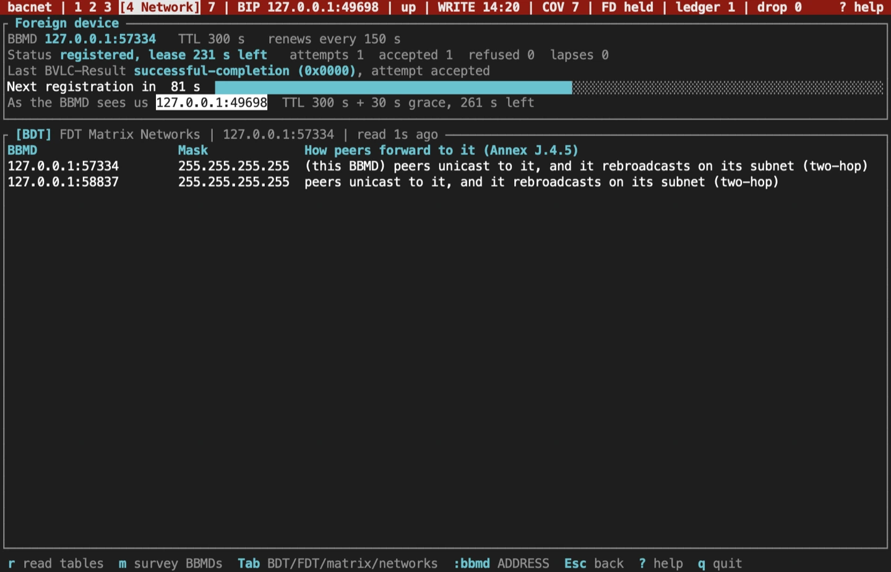
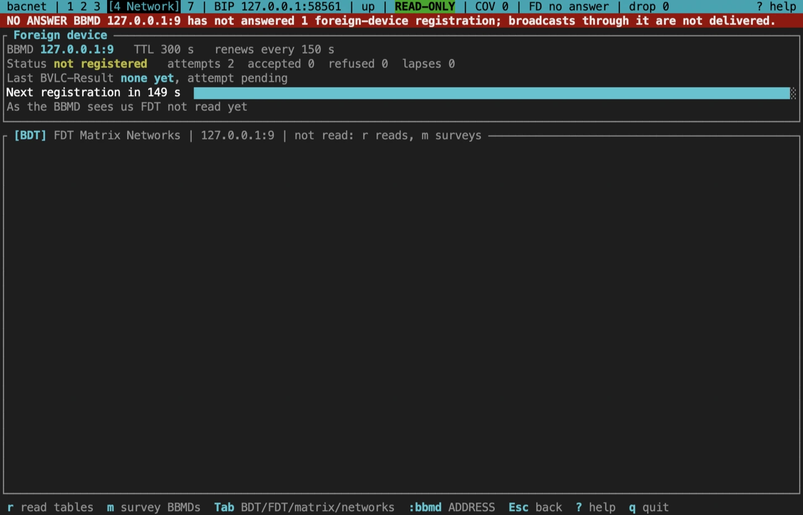
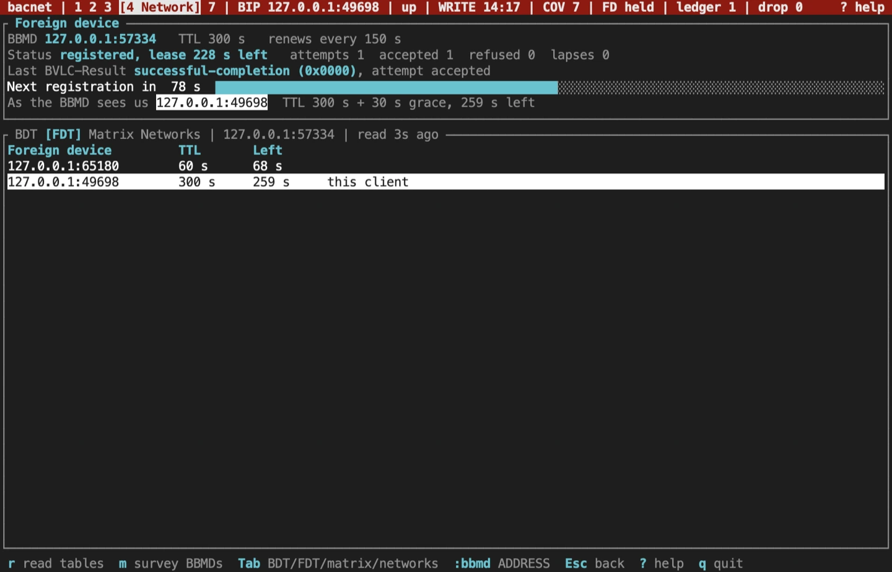
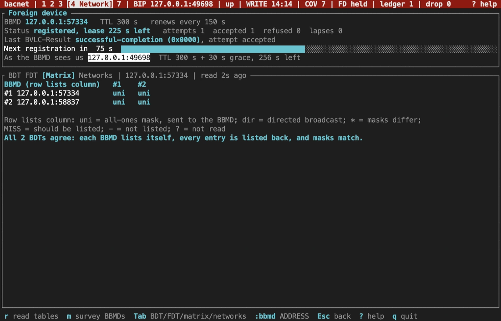
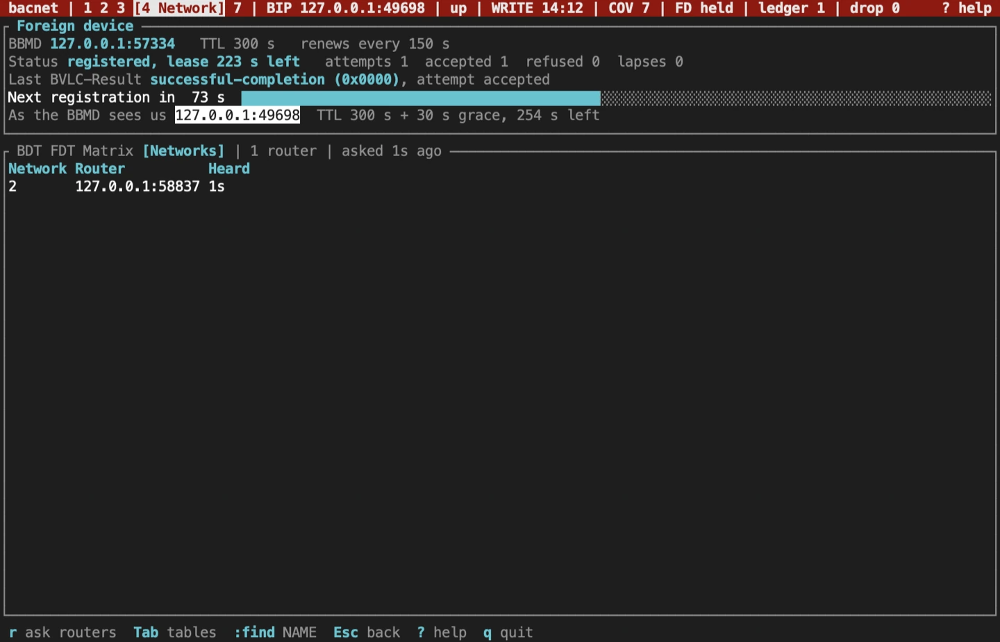

import NextStep from '../../../components/NextStep.astro';
import { release, repository } from '../../../lib/site.mjs';

The Network screen, `4`, is where B/IP broadcast problems show. Its BBMD tabs are for B/IP. Its Networks tab, which maps routers, works on every transport. Every read here is a BVLC or network-layer request; nothing on this screen writes to a BBMD or a router.

## The foreign-device panel

When the session runs as a foreign device (a profile with a BBMD, or `--foreign-bbmd`), the top panel follows the registration:

- **BBMD, TTL and renewal.** Where the TUI registers, for how long, and how often it renews (half the TTL unless set).
- **Status.** Registered with the lease left, or not registered; with the count of attempts, acceptances, refusals and lapses.
- **Last BVLC-Result.** The BBMD's answer to the latest registration, with its code.
- **Next registration.** A countdown bar to the next renewal.
- **As the BBMD sees us.** Once the BBMD accepts, the TUI reads its FDT and shows the entry recorded for this client: the address the BBMD forwards broadcasts to. If no entry has our address, a NAT router may have rewritten it.

A BBMD that never answers leaves the status at `not registered`, with the attempt count rising. A refusal raises a red banner on every screen.

## BDT and FDT

Below the panel, tabs show one BBMD's tables. Tab and Shift-Tab move between BDT, FDT, Matrix and Networks; `r` reads the tables again. The title names the BBMD and how long ago it was read.

- **BDT**, the broadcast distribution table: each peer BBMD with its mask, and what that mask means for forwarding. An all-ones mask means peers send to that BBMD, which then rebroadcasts on its own subnet (two hops). Other masks mean a directed broadcast (Annex J.4.5).
- **FDT**, the foreign-device table: each registered foreign device with its TTL and the seconds left. This client's own entry is marked.

To read another BBMD's tables, run `:bbmd ADDRESS` (`ip` or `ip:port`, port 47808 by default). The tabs then show that BBMD, and the footer offers `:bbmd` alone, which goes back to the tables of the BBMD you register with.

## The consistency matrix

Every BBMD in a site should list every other one, the same way each time. `m` surveys them: it reads the BDT of every BBMD the tables lead to, up to 16, and shows which lists which.

Each cell says how the row BBMD lists the column BBMD: `uni` for an all-ones mask, `dir` for a directed broadcast, `*` when the masks differ, `MISS` where an entry should be, `-` for not listed and `?` for not read. The survey flags:

- a peer listed one way only;
- a BDT without its own entry;
- a BBMD listed with different masks;
- BBMDs that refuse the read or don't answer.

The matrix matches BBMDs by address. A BBMD reached at an address other than its own BDT entry, behind NAT for example, shows as two rows, one flagged with no entry for itself.

## Routers and networks

The Networks tab lists routers and the networks they reach. `r` clears the map and asks every router, by broadcasting Who-Is-Router-To-Network. Every router that announces itself, asked or not, is listed against its networks, with how long ago it was heard.

A network number that more than one router claims is flagged `DUPLICATE`: two networks may share the number, the routers may form a loop, or the route may have moved since the last search. The tab's title shows the local network number once a Network-Number-Is is heard. A router's Reject-Message-To-Network for a message the TUI sent shows in the footer with the network and the reason.

## Sources and release scope

These pages describe **v{release}**. Source review is not a claim of hardware qualification. BBMD and foreign-device behaviour is in ASHRAE 135 Annex J.

<a href={`${repository}/blob/v${release}/docs/CLI.md#plain-bacnet`}>Network screen reference</a> · <a href={`${repository}/blob/v${release}/crates/bacnet-cli/src/tui/network/matrix.rs`}>Consistency matrix</a> · <a href={`${repository}/blob/v${release}/crates/bacnet-cli/src/tui/network/routers.rs`}>Router map</a>.

<NextStep href="/rusty-bacnet/tui/bacnet-sc/" label="Diagnose BACnet/SC" description="Check the hub connection, certificates and the connection doctor." />
