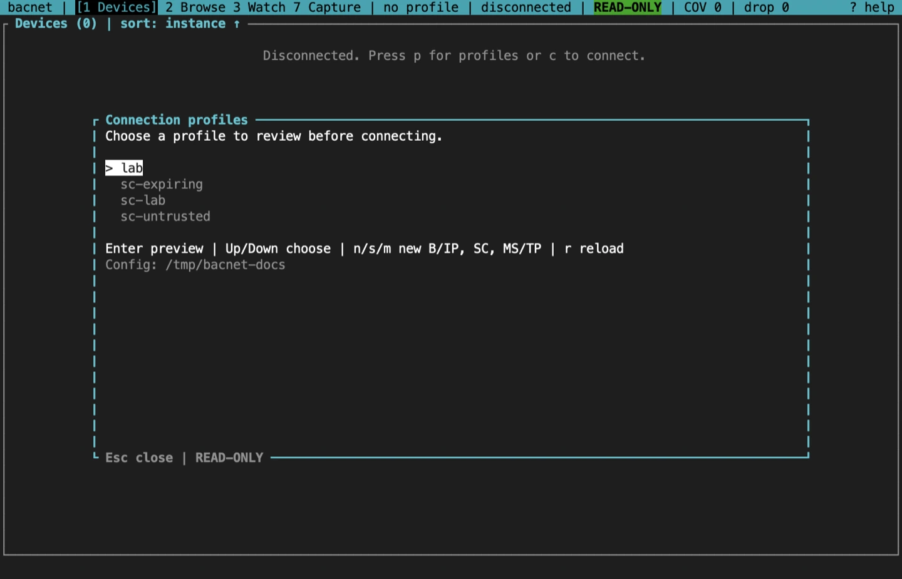
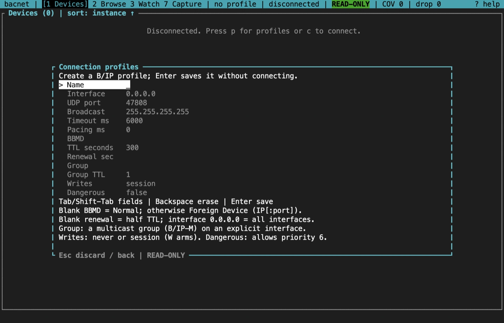
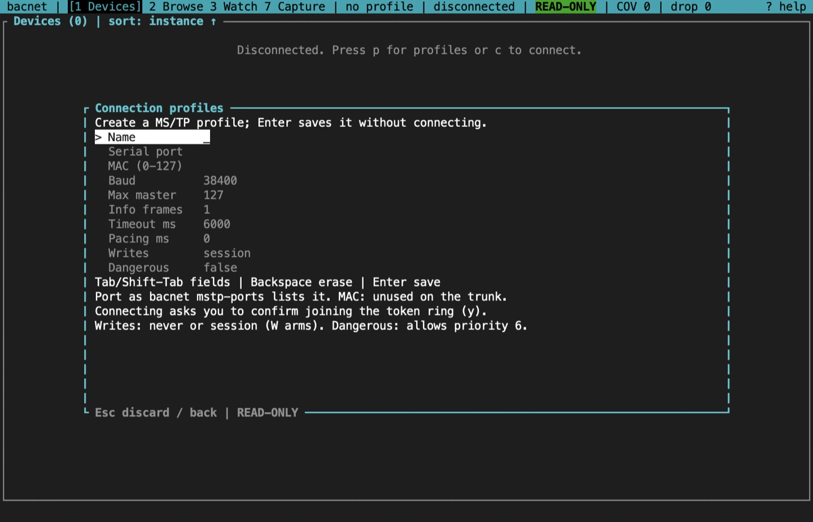
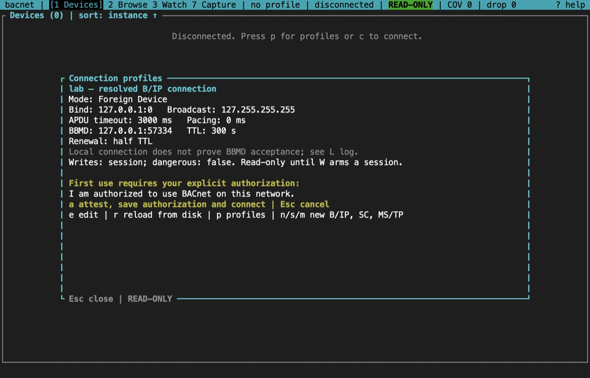
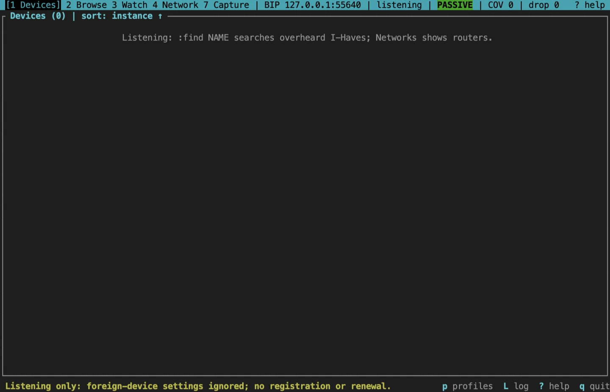

import NextStep from '../../../components/NextStep.astro';
import { release, repository } from '../../../lib/site.mjs';

A profile is a saved connection: one transport, its settings, and a safety policy. The TUI previews a profile before it connects, so you see exactly where it will bind and what it may send.

## Two ways in

- **With a profile.** `bacnet tui` opens the profile dialog, and `bacnet tui --profile NAME` goes straight to that profile's preview. Flags you add on the command line override the saved values for this run only; they are never written back. A flag for another transport, such as `--port` on an SC profile, is an error.
- **Flags only.** Global network flags without `--profile`, or `--no-profile`, connect with those flags and read or write no profile. This is also the only way to use B/IPv6. A flags-only session can't arm writes, because the write ledger and audit log live in a profile's workspace.

On B/IP without `-i`, a flags-only session lists the host's IPv4 interfaces in a dialog first; with a single interface it uses that one without asking.

## The profile dialog

`p` opens the dialog from any screen. It has three views: the list, a preview, and the editor.



In the list, Up and Down (or Tab and Shift-Tab) choose, Enter previews, `r` reloads the list from disk, and `n`, `s` or `m` create a B/IP, BACnet/SC or MS/TP profile. The dialog shows the config directory at the bottom.

### Create a profile



Tab and Shift-Tab (or Up and Down) move between fields, Backspace erases, and Enter saves without connecting. Esc discards the draft. A failed save keeps the draft and shows why; a new profile never overwrites an existing name.

| Transport | Fields |
|---|---|
| B/IP | Name, interface, UDP port, broadcast address, APDU timeout, pacing, BBMD, TTL, renewal, multicast group, group TTL, writes, dangerous |
| BACnet/SC | Name, hub URL, failover hub URL, CA, certificate and key files, VMAC, device UUID, timeout, pacing, connect timeout, reconnect (on or off), writes, dangerous |
| MS/TP | Name, serial port, MAC (0 to 127), baud, Max_Master, Max_Info_Frames, timeout, pacing, writes, dangerous |

Some fields change the mode as well as a value:

- **B/IP BBMD.** Blank runs in normal mode. An address (`IP` or `IP:port`) registers as a foreign device with that BBMD. A blank renewal renews at half the TTL. Interface `0.0.0.0` binds every interface, and port `0` takes any free port.
- **SC files.** Only the paths of the PEM files are saved, never their contents, and relative paths are made absolute. A blank VMAC and device UUID are generated once, when the profile is first saved or first connected, and then kept, so the device UUID stays the same across restarts. After that the editor shows them read-only.
- **MS/TP port.** Use the name `bacnet mstp-ports` lists, and a MAC no other station on the trunk uses.



### Preview and first-use attestation



The preview shows the settings that will be used, after any flag overrides: the mode, the bind address and broadcast, the timeouts, the BBMD and TTL, and the safety policy. In it, `e` edits, `r` reloads the file and checks it again, `p` returns to the list, and `x` disconnects a live session while the dialog stays open.

The first time you use a profile, the preview asks you to confirm that you are authorized to use BACnet on that network. Press `a` to attest: the TUI saves the time of your attestation in the profile, and only then builds a client. Enter alone does not attest. Later connections use Enter or `c`. Editing the saved network settings clears the attestation, and so does raising the write policy.

For a BACnet/SC profile the preview also checks the credential files before anything is sent; see [the BACnet/SC screen](/rusty-bacnet/tui/bacnet-sc/#before-the-dial).

## Session levels

The status bar always shows the level:

| Level | What the TUI may send |
|---|---|
| `READ-ONLY` | The default. Discovery, reads, COV subscriptions with a finite lifetime, and a foreign-device registration. No writes |
| `WRITE mm:ss` | A write session is armed, shown in red with its countdown. Writes are allowed, each one previewed and confirmed |
| `PASSIVE` | Nothing at all. No client is built |

### Passive sessions

```sh
bacnet tui --profile plant-a --passive
```

`--passive` builds no client, so nothing is transmitted: no discovery, reads, subscriptions, registrations or writes. Those keys show a notice instead. You can still open the profile dialog and read the session ledger with `u`. Use it to check a profile, or to look at what an earlier session left behind, without touching the network.



### The safety policy

Each profile has a `[safety]` table:

- `writes = "session"`, the default, lets `W` arm a write session. `writes = "never"` makes `W` say why and arm nothing.
- `dangerous = true` allows a write at priority 6 inside an armed session. It needs `writes = "session"`.

[Write safely](/rusty-bacnet/tui/writes/) explains arming, the confirmation tiers and the ledger.

## Connect, disconnect and reconnect

- `c` connects, or reconnects after a disconnect. A profile session shows its preview again first.
- `x` disconnects, or cancels a connection that is still being made. The TUI waits for the transport to be released before you can load or edit another profile.
- A failed connection stays on screen with the reason, so you can fix the settings (`p`) and retry (`c`).

Disconnecting stops the local foreign-device renewals. The BBMD's entry for you is not removed at once; it expires after its TTL and grace period (Annex J.5.2).

## Where profiles live

| Platform | Config directory |
|---|---|
| Linux | `$XDG_CONFIG_HOME/bacnet`, usually `~/.config/bacnet` |
| macOS | `~/Library/Application Support/bacnet` |
| Windows | `%APPDATA%\bacnet\config` |

`BACNET_CONFIG_DIR` replaces the whole directory, workspaces included:

```sh
BACNET_CONFIG_DIR=/srv/bacnet/site-a bacnet tui
```

Inside it, `profiles/NAME.toml` holds each profile and `workspaces/NAME/` holds that profile's session ledger (`ledger.json`), audit log (`audit.jsonl`) and watch-list CSV logs. Names are 1 to 64 ASCII letters, digits, `_` or `-`. If you change a file outside the TUI, press `r` in the dialog to reload it. A save that finds the file changed on disk is refused and leaves the file alone.

A B/IP profile file looks like this; the <a href={`${repository}/blob/v${release}/docs/CLI.md#plain-bacnet`}>terminal UI reference</a> shows the SC and MS/TP tables:

```toml
version = 1
transport = "bip"
# authorized_at_unix is added after the first-use attestation.

[bip]
interface = "10.0.1.5"
port = 47808
broadcast = "10.0.1.255"
timeout_ms = 6000
min_interval_ms = 0
ttl = 300
# bbmd = "10.0.2.1:47808"

[safety]
writes = "session"
dangerous = false
```

## Sources and release scope

These pages describe **v{release}**. Source review is not a claim of hardware qualification.

<a href={`${repository}/blob/v${release}/docs/CLI.md#plain-bacnet`}>Profiles and connection lifecycle</a> · <a href={`${repository}/blob/v${release}/crates/bacnet-cli/src/tui/profile/store.rs`}>Profile store</a> · <a href={`${repository}/blob/v${release}/crates/bacnet-cli/src/paths.rs`}>Config directory</a>.

<NextStep href="/rusty-bacnet/tui/discovery/" label="Discover devices" description="Send a scoped Who-Is, sort and filter the table, and find objects by name." />
