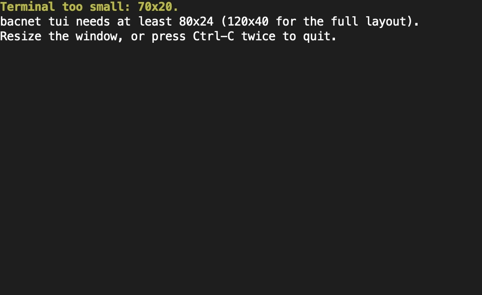
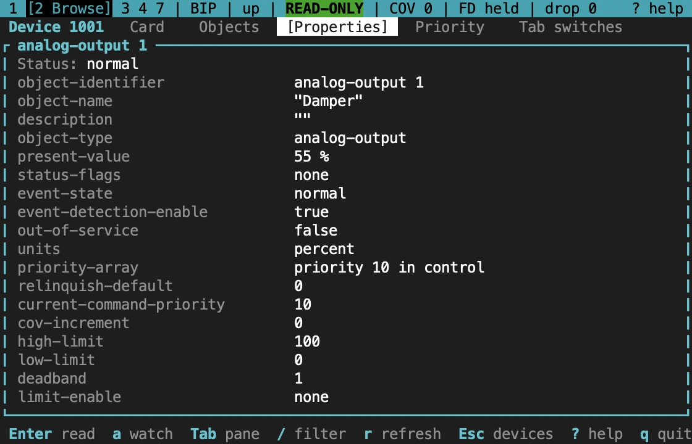

import NextStep from '../../../components/NextStep.astro';
import { release, repository } from '../../../lib/site.mjs';

Most problems with the TUI are about the terminal it runs in. For network problems, such as no I-Am replies or a timeout, see [Troubleshooting](/rusty-bacnet/help/troubleshooting/).

## The terminal is too small

The TUI needs at least 80 columns and 24 rows. Below that it shows a notice until the window grows; Ctrl-C twice quits from there.



From 120 columns the tables use their wide columns and the browser shows its panes side by side; from 40 rows the log pane gets more room. Between 80 and 120 columns the browser shows only the focused pane, and Tab moves to the next one. The bar under the status line names the panes.



## It won't open

`bacnet tui` needs stdin and stdout to be a terminal, and `TERM` must not be `dumb`. Otherwise it exits with status 1 and a hint on stderr, and writes nothing to stdout. Plain `bacnet` in the same place prints the usage and exits with status 2.

- **In a script or a pipe,** use the one-shot commands with `--json`, such as `bacnet discover --json`.
- **`bacnet` prints the usage at a terminal.** Check for `--no-tui` and the `BACNET_NO_TUI` variable, and that the build has the TUI: `bacnet tui` says how to rebuild when it was left out.
- **On Windows,** use Windows Terminal or the classic console (conhost). mintty, Git Bash and other MSYS terminals refuse raw mode, and the TUI exits with the same hint.

## Colours

Colour is never the only signal: status badges such as `[ALM]` and `[OOS]`, the `>` priority marker and the level names are text. To turn colour off, set `NO_COLOR` to any non-empty value:

```sh
NO_COLOR=1 bacnet tui
```

Styles then fall back to bold, dim and reverse video. The TUI uses the terminal's own palette, so if a colour is hard to read, change the terminal's theme or use `NO_COLOR`.

## Over SSH

The TUI runs well on a machine already on site, over SSH. Ask for a terminal when you run it directly:

```sh
ssh -t engineer@site-gateway bacnet tui --profile plant-a
```

On a slow link, `--fps 5` lowers the redraw rate. Screens that aren't changing aren't redrawn at all.

## Inside tmux or screen

The TUI works inside tmux and GNU screen. Two settings help in tmux:

- tmux waits half a second by default to tell Esc from the start of a key sequence, so Esc feels slow. Set `set -sg escape-time 10` in `~/.tmux.conf`.
- Use a 256-colour terminal type, such as `set -g default-terminal tmux-256color`.

## The terminal was left in a strange state

The TUI restores the terminal when it exits, when it panics, and when a signal ends it (SIGINT, SIGTERM or SIGHUP; console close or Ctrl-Break on Windows). If a terminal is still left without echo or in the alternate screen, `reset` restores it.

## Logs

- `L` shows the log pane, with the latest of up to 1,000 lines.
- `--log-file FILE` also appends every line to a file, which survives the session.
- `-v` and `-vv` raise the level to debug and trace.

A profile's workspace also holds `audit.jsonl`, the record of every write session, and `ledger.json`, the changes still in effect. See [Write safely](/rusty-bacnet/tui/writes/#the-audit-log).

## Other symptoms

| Symptom | What to check |
|---|---|
| A red error in the footer after connecting | The connection failed. `p` opens the profile to fix it, `c` retries |
| `drop` counts up | The UI fell behind a burst of traffic. The tables are refreshed from the client afterwards; lower `--fps` or narrow the Who-Is |
| `W` says another process holds the profile | Another `bacnet tui` has that profile open. Only one may change its ledger at a time |
| A profile edited by hand doesn't change | Press `r` in the profile dialog to reload it |
| No profiles where you expect | Check the config directory the dialog shows, and `BACNET_CONFIG_DIR` |
| A screen reader can't follow the TUI | The TUI redraws a whole screen at a time. Use the one-shot commands with `--json` or `--format table` |

## Sources and release scope

These pages describe **v{release}**. Source review is not a claim of hardware qualification.

<a href={`${repository}/blob/v${release}/docs/CLI.md#plain-bacnet`}>Requirements and exit status</a> · <a href={`${repository}/blob/v${release}/crates/bacnet-cli/src/tui/terminal.rs`}>Terminal setup and restore</a> · <a href={`${repository}/blob/v${release}/docs/design/tui.md`}>TUI design notes</a>.

<NextStep href="/rusty-bacnet/tui/overview/" label="Back to the overview" description="Install, open, and read the TUI's layout." />
