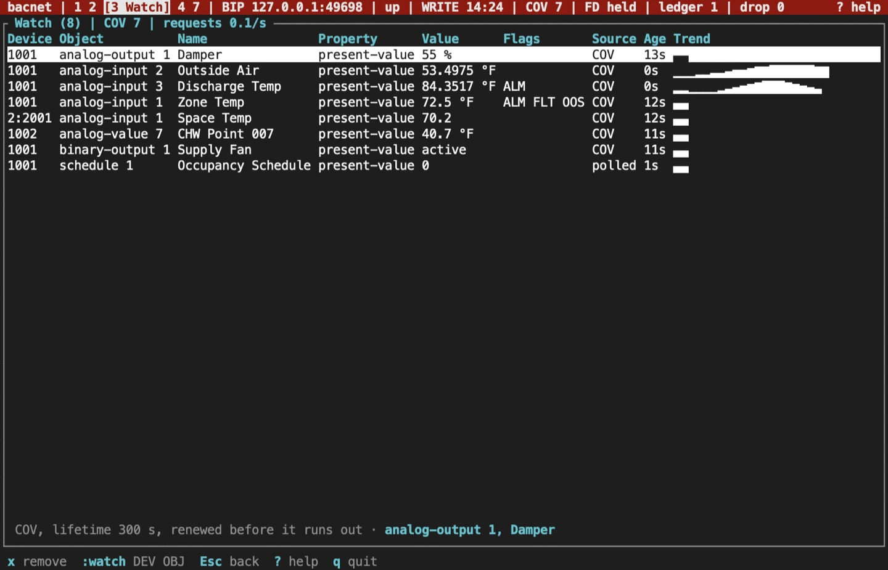

import NextStep from '../../../components/NextStep.astro';
import { release, repository } from '../../../lib/site.mjs';

The watch list, screen `3`, follows chosen properties as they change. Each row asks the device to report changes by COV where it can, and polls where it can't.



## Add a point

- In the browser, `a` watches the open object's Present_Value.
- On the command bar, `:watch DEVICE OBJECT [PROPERTY]` watches any property of a device in the device table. `:w` is short for `:watch`. The property defaults to Present_Value.

```text
:watch 1001 ai:2
:watch 1001 av:1 high-limit
:watch 2:2001 ai:1
```

A routed device is named `DNET:instance`, as in the last line, or by the station the device table shows, such as `2:0x05`. If you type a network the device table disagrees with, the table's network is used and the footer says so, such as `2001 is on network 2, not 3`. Objects take the one-shot shorthand (`ai:1`) or the full name (`analog-input:1`). A mistake shows in the footer, such as `unknown object type: 'zz'`.

## Read a row

Each row shows the device, object, name and property, the latest value with its unit symbol (`72.5 °F`) or its state text (`active (Running)`), the status flags as `ALM`, `FLT`, `OVR` and `OOS`, the source (`COV` or `polled`), how long ago the value arrived, and a sparkline of recent numeric values. A routed device shows as `NET:INSTANCE`, such as `2:2001`. The name comes with the row's first read; a device that won't give it leaves the row without one.

The columns fit what they hold, and the device and object are never cut. Below 120 columns the property column shows only when a row watches something other than Present_Value, and a long name is shortened; a row too wide for the screen gives up value width first, then the age and source columns. The line under the table starts with the selected row's subscription (COV, or polled and why), then names the row: its object, its property when that isn't Present_Value, and as much of its name as fits. From 120 columns the property always shows, and from 160 the units name too, with longer names and a longer sparkline. The title shows how many rows there are, how many COV subscriptions the list holds, and its request rate over the last 10 seconds.

## COV and polling

Each row first subscribes for COV with a finite lifetime: SubscribeCOV for Present_Value and SubscribeCOVProperty for any other property. The lifetime is `--cov-lifetime` seconds, 300 by default, and the TUI renews the subscription before it runs out. The status bar's `COV` count is the number of subscriptions the session holds on devices.

A row is polled instead when:

- the device refuses the subscription;
- the device is routed, as row `2:2001` is above;
- a renewal fails. The row turns to polling and tries to subscribe again later, waiting longer after each failure.

Polling reads up to 16 rows of one device with one ReadPropertyMultiple. A point is polled at most every `--poll-interval` seconds, 10 by default, counted from the end of its last poll, and within the shared `--max-rate`. A device that stops answering is polled again after a wait that doubles up to a minute.

The watch list keeps at most one of its own requests outstanding per device. The browser has its own one-per-device limit, so a device you browse while watching can have one of each. Renewals go out once per lifetime, outside both limits.

## Remove a point

`x` (or Delete) stops watching the selected row and cancels its subscription on the device. Quitting cancels every subscription the list holds, so the TUI leaves no COV state behind on a clean exit. A subscription left by a crash expires at the end of its lifetime.

## Log values to CSV

With a profile, `:csv on` writes every value the watch list receives to `watch-TIME.csv` in the profile's workspace, and `:csv off` stops. A flags-only session has no workspace, so it can't log.

The columns are `unix_ms`, `device`, `object`, `property`, `value`, `status_flags`, `source` and `network`. `device` is always the plain instance number; `network` holds a routed device's network number and is empty for a device on the local network. Values are logged exactly, with every digit and without state texts.

## Sources and release scope

These pages describe **v{release}**. Source review is not a claim of hardware qualification.

<a href={`${repository}/blob/v${release}/docs/CLI.md#plain-bacnet`}>Watch list reference</a> · <a href={`${repository}/blob/v${release}/crates/bacnet-cli/src/tui/watched.rs`}>Watched points</a> · <a href={`${repository}/blob/v${release}/crates/bacnet-cli/src/tui/app/watch.rs`}>Watch screen</a>.

<NextStep href="/rusty-bacnet/tui/network/" label="Inspect BBMDs and routers" description="Check foreign-device registration, BDT and FDT, the BDT matrix and the networks routers reach." />
