import NextStep from '../../../components/NextStep.astro';
import { release, repository } from '../../../lib/site.mjs';

Writes reach live equipment. A wrong priority can override a life-safety command, and a forgotten value can hold a damper or a fan for weeks. So the TUI guards every write: you arm a session for a limited time, each write is previewed against what the device holds now, the confirmation gets harder as the priority rises, and every change is kept so you can undo it.

## Arm a write session

The TUI is read-only until you press `W`. Arming needs a profile whose policy is `writes = "session"`, because the profile's workspace holds the ledger and the audit log. A flags-only session, or a profile with `writes = "never"`, can't arm.

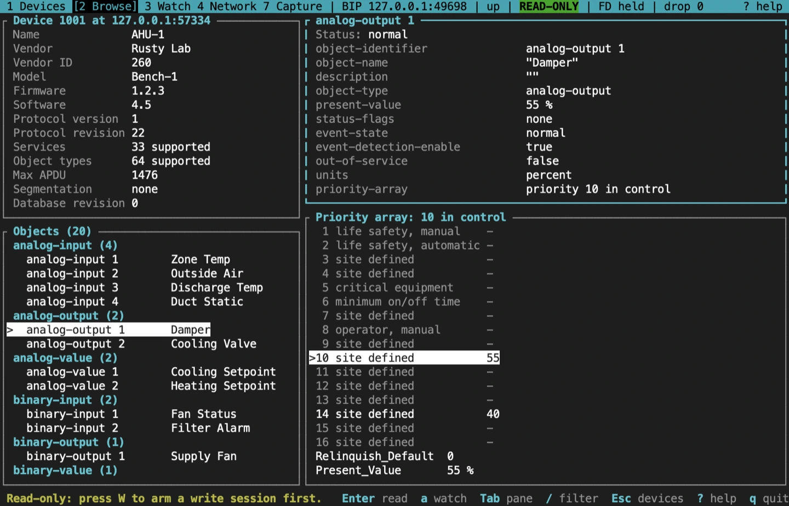

The arm dialog names the site and the network, and takes an optional reason (a ticket or a note, which goes in the audit log) and a length in minutes: 15 by default, at most 480.

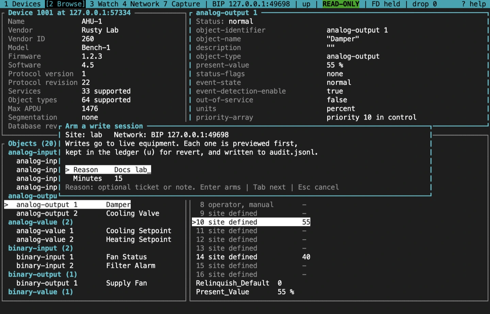

While the session is armed, the status bar turns red and counts down, `WRITE 14:58`. At zero the session disarms itself; `W` disarms it early. A profile's ledger has one writer at a time, and `bacnet mcp serve` shares the lock with the TUI: a second `bacnet tui` on the same profile can't arm, and an MCP write to that profile is refused while the TUI holds it. Each is told which process holds the lock, such as `bacnet tui (pid 4242)`.

## Write a property

Open an object in the browser and press `w`.

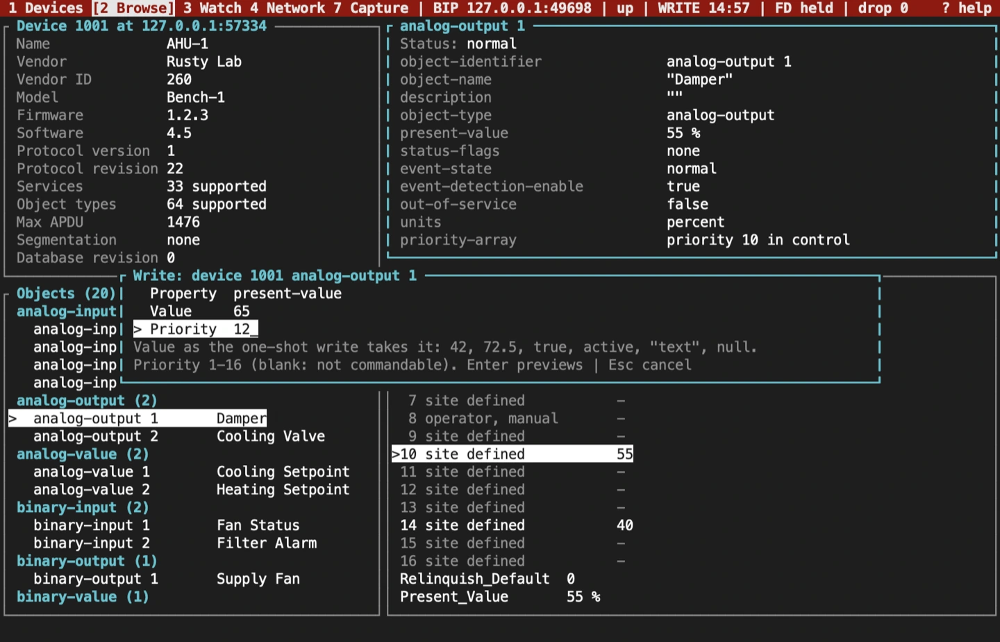

- **Property** defaults to Present_Value.
- **Value** uses the one-shot `write` syntax: `42`, `72.5`, `true`, `active`, `"text"` or `null`. A number is sent as the datatype the property already holds, and `null` is a relinquish. Enumerations and bit strings take the names the browser shows (`offnormal`, `in-alarm | fault`), and dates and times the browser's forms, so a value shown can be typed back. A mistyped name is refused with the valid choices.
- **Priority** defaults to 16 for a commandable object. Leave it blank when the property has no priority array.

Enter reads the object again and shows a preview.

## Read the preview

Before every write the TUI reads the object's priority array, Present_Value, Relinquish_Default and Out_Of_Service. The preview then shows:

- the slot or property, with its old and new value;
- who holds the slot now: nobody, an earlier write of yours, or another commander, whose value yours replaces without telling them;
- whether Present_Value will change. A write at a lower priority than the one in control won't change it.

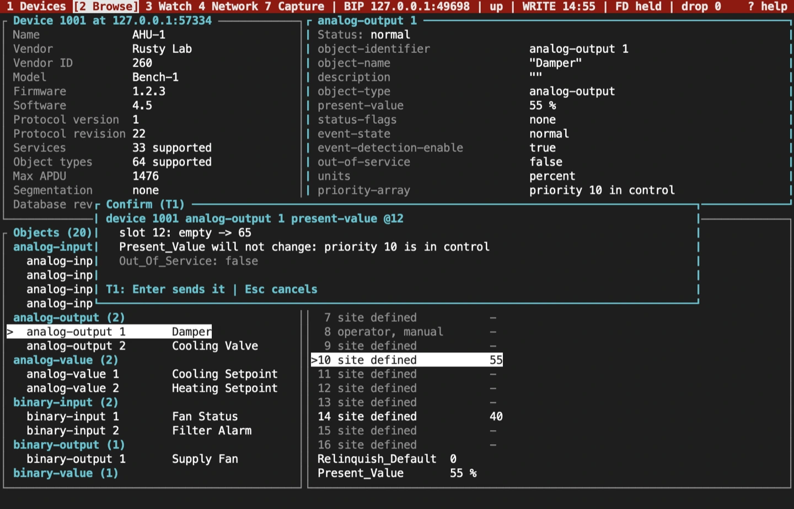

## Confirm by tier

The confirmation depends on what the write can affect:

| Tier | Writes | Confirm with |
|---|---|---|
| T1 | Priorities 9 to 16, and properties that aren't commandable | Enter |
| T2 | Priorities 3, 4, 7 and 8; Out_Of_Service; relinquishing a slot another commander holds; any `writem` batch | `y` |
| T3 | Priorities 1, 2 and 5: life safety and critical equipment | Type the device instance, then Enter |
| Blocked | Priority 6, kept for minimum on and off times (Clause 19.2) | Refused, unless the profile sets `dangerous = true`; then T3 |

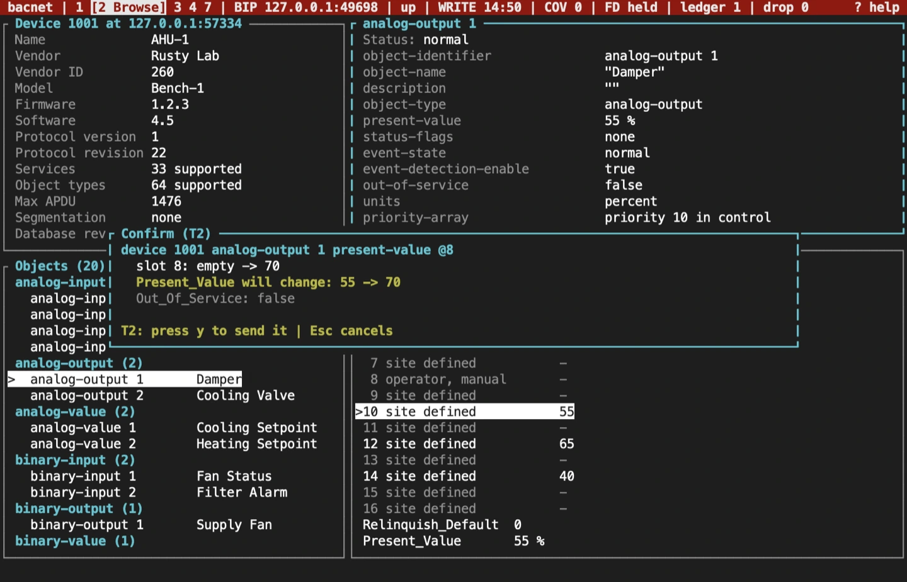

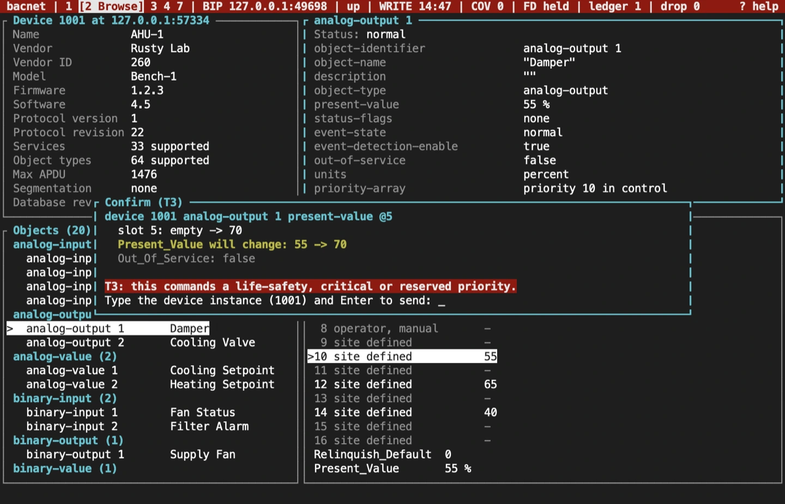

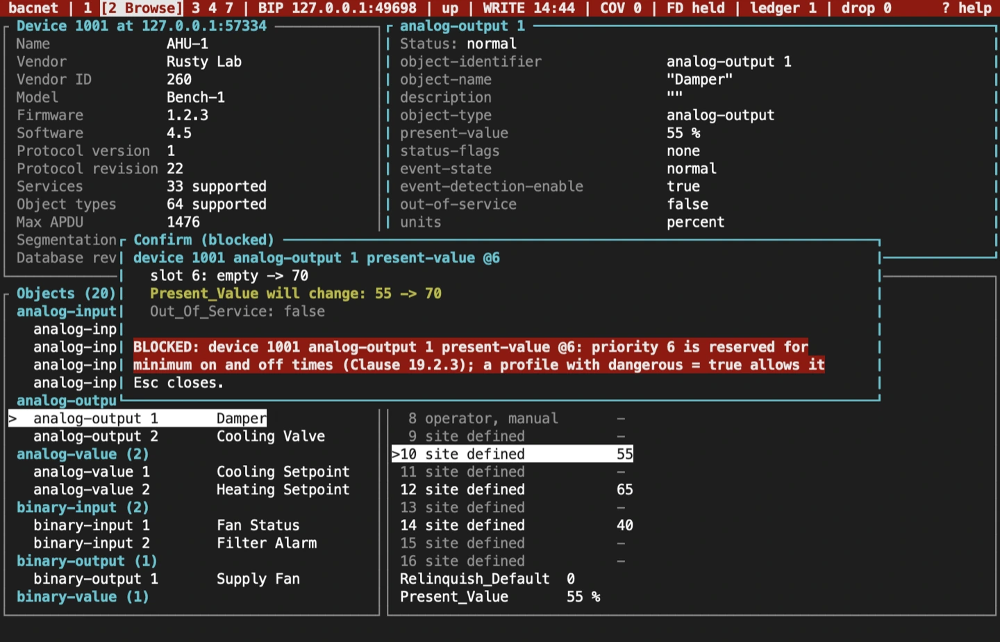

Three more guards stop a write you didn't mean:

- Enter and `y` do nothing for 300 ms after a preview opens, so a repeating key can't confirm it unseen.
- A preview left for two minutes is declined.
- Just before sending, the TUI reads the target again. If the old value or the slot's holder changed since the preview, nothing is sent and the result asks you to review it again.

Esc declines. Nothing is sent, and the audit log records the decline.

## The result

The result lists each write's outcome. A device whose own policy refuses the write (SERVICE_REQUEST_DENIED) is shown as `DENIED`, apart from other errors. Once a write is in effect, the status bar counts it: `ledger 1`.

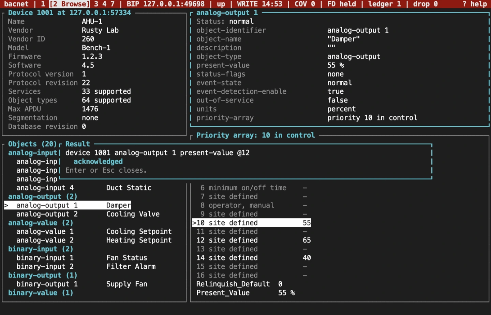

## Relinquish a slot

`n` writes NULL to one priority slot, so the next priority down, or Relinquish_Default, takes over. It is previewed and confirmed like any other write. Relinquishing your own slot follows the priority's tier; relinquishing a slot another commander holds is always at least T2.

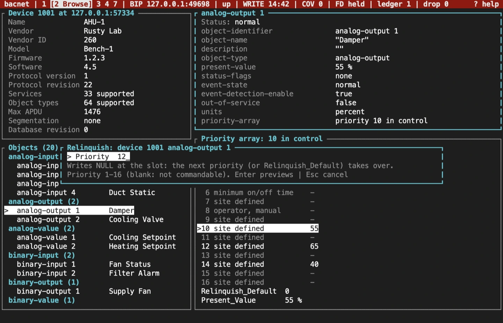

## Several writes at once

`:writem DEVICE OBJECT PROPERTY VALUE[@PRIORITY] ...` sends several writes to one device as one WritePropertyMultiple. For example:

```text
:writem 1001 av:1 present-value 72@12 av:2 present-value 68@12
```

A batch is always at least T2. Each property may appear only once in a batch, because a failed batch names the failing write without its priority.

To write text with spaces, quote it, or escape each space with a backslash. A quoted or escaped value is a character string, and a priority goes after the closing quote or the last escape:

```text
:writem 1001 av:1 description "Zone 2 supply"@12
```

Single and double quotes both work, and a backslash makes the quote, whitespace character or backslash after it plain text (`\"`, `Zone\ 2`). A quoted number, such as `'72.5'`, is a string too, so a numeric property refuses it. A quote left open is an error, and nothing is previewed.

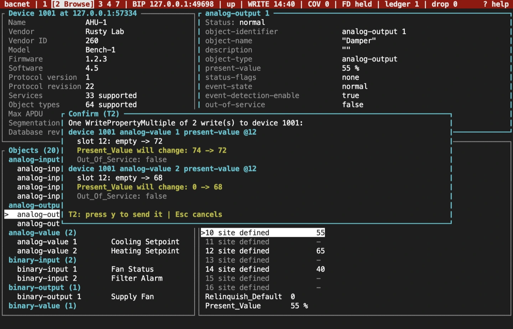

## DCC and reinitialize

Two command bar commands reach a whole device rather than one property:

- `:dcc enable`, `:dcc disable-initiation [MINUTES]` and `:dcc disable [MINUTES]` send DeviceCommunicationControl. `:control` is the same command. A disable without a duration lasts 15 minutes. Type `forever` instead of the minutes for no time limit: the change then lasts until a `:dcc enable` or a restart. `enable` takes no duration.
- `:reinit STATE` sends ReinitializeDevice. The states are the one-shot `reinit` command's: `coldstart`, `warmstart`, `start-backup`, `end-backup`, `start-restore`, `end-restore`, `abort-restore` and `activate-changes`.

For example, to stop a device starting conversations for half an hour:

```text
:dcc disable-initiation 30
```

Both go to the device in front of you: the device open on the Browse screen, or the selected row on the Devices screen. Elsewhere, or with no device selected, they are refused and say so.

Both need an armed write session on a profile that sets `dangerous = true`. Without that opt-in they are refused with the reason. A passive or monitor-only session refuses them too, because it transmits nothing.

Next comes a password prompt. What you type shows as `*`, Backspace erases, and a blank password sends none. A password can be up to 20 characters (Clauses 16.1.1.1.3 and 16.4.1.1.2). Esc cancels and clears what you typed.

The confirmation is always T3: type the device instance, then Enter. It names the service, the state, the duration (such as `for 15 min (default)` or `no time limit`), and whether a password goes with it, never the password itself. A `disable` gets a warning, because that option is deprecated (Clause 16.1) and current devices refuse it.

The result shows the device's answer, an acknowledgement or its error, such as a wrong password. Neither request is kept in the ledger, since revert can't undo it. The audit log records the service, the device, the state, the duration and the outcome. When a password was sent, its field is written as `[redacted]`. The password goes in the request on the wire, as the protocol requires, and nowhere else: not the audit log, the ledger, the profile, the logs or the screen. The Capture screen keeps the request with each character of its password replaced by `*`, says "password redacted" over its detail, and exports it that way.

## The ledger: undo what you changed

Every change still in effect is kept in the profile's `ledger.json` with its pre-image, the value it replaced. The ledger is saved before each request goes out and after each answer, so it outlives a crash. A slot counts as yours only while it still holds what you wrote; if someone has written over it since, it is treated as theirs.

`u` opens the ledger. `R`, then `y`, reverts everything, newest first: your slots are relinquished, or given back the value another commander had there, and other properties get their old value back. A write to one array element, such as `state-text[2]`, puts back just that element. If the old value couldn't be read before the write, revert leaves the entry and says why. Writing index 0, the array's length, resizes the array and is never reverted. Writes to one array, by element and whole, revert to the array as it was before the first of them. Reverting needs a connection but not an armed session. A device not yet discovered, after a restart for example, is looked for first.

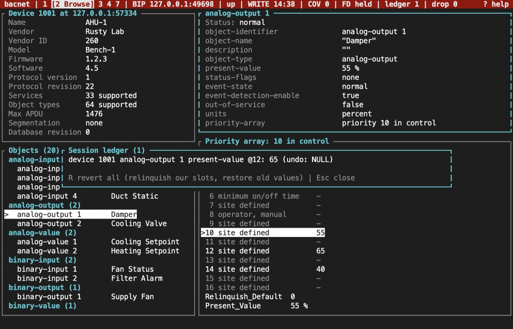

Quitting with entries in the ledger opens the exit guard:

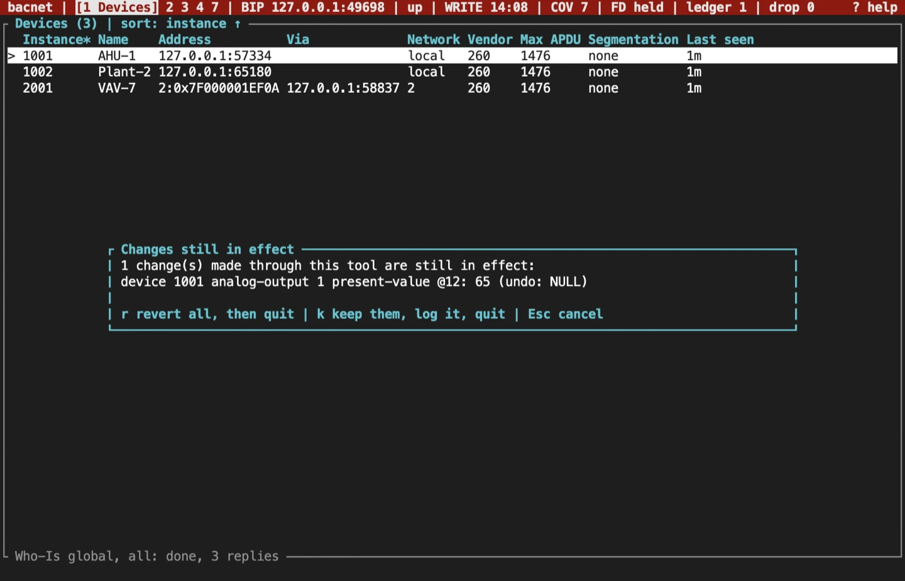

- `r` reverts everything, then quits.
- `k` keeps the changes, records that in the audit log, and quits.
- Esc cancels and stays.

Entries an earlier run kept, or left behind in a crash, are listed when the next session on that profile starts. One that a crash cut off mid-request is recorded as unknown.

## The audit log

`audit.jsonl` in the profile's workspace gets one JSON object a line, flushed to disk as it goes: the time, the OS user and host, the profile, transport and local address, the session level, the event, and for a write its target, service, priority, pre-image and outcome. A `sending` record is written before each request. Arming, disarming, refusals, declines, reverts and kept entries are logged too. Reads are not. Each record also names its `front_end`, `tui` or `mcp`, and for an MCP write the `principal` that made it, since `bacnet mcp serve` writes to the same log. Any field whose name contains `password`, `token`, `authorization`, `secret` or `key` is written as `[redacted]`, however deeply it is nested. This is the TUI's own record, separate from BACnet audit reporting.

## Sources and release scope

These pages describe **v{release}**. Source review is not a claim of hardware qualification. Command priorities are described in ASHRAE 135 Clause 19.2, and the device management services in Clause 16.

<a href={`${repository}/blob/v${release}/docs/CLI.md#write-sessions`}>Write sessions reference</a> · <a href={`${repository}/blob/v${release}/crates/bacnet-ops/src/safety/plan.rs`}>Write plan and tiers</a> · <a href={`${repository}/blob/v${release}/crates/bacnet-ops/src/safety/ledger.rs`}>Ledger</a>.

<NextStep href="/rusty-bacnet/tui/watch/" label="Watch points" description="Follow values by COV or polling, with sparklines and renewals." />
